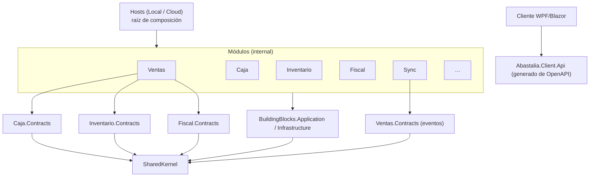
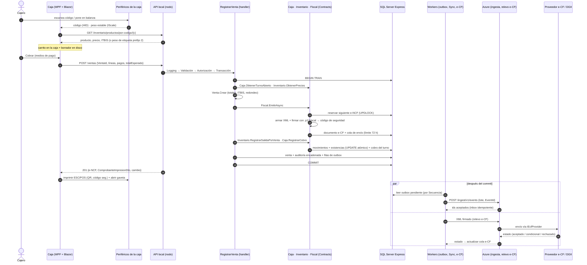

# Arquitectura de código V1: Vertical Slices + monolito modular

> Estado: **propuesta de diseño**, 14 oct 2026. No hay código todavía.
> Se construye **sobre** `docs/arquitectura-v1.md` (modelo híbrido local-first, ya decidido) y usa `read-v1.md` y *planes* (doc. privado) como contexto. Aquí no se vuelve a decidir el despliegue: se decide **cómo se organiza el código**.
> El producto se llama **Abastalia** (decidido el 14 de octubre de 2026); se usa como prefijo de los proyectos.
> Las licencias y versiones de paquetes se verificaron en la web en esta fecha. Lo que no se pudo verificar lleva **(verificar)**.

---

## 1. Resumen

Abastalia V1 es un **monolito modular** en **.NET 10 (LTS)**. El mismo conjunto de módulos (Ventas, Caja, Inventario, Compras, Clientes/Fiado, Fiscal, Hardware, Identidad, Configuración/Licencia y Sync) se monta en dos *hosts*: el **host local**, una API ASP.NET Core que corre como servicio de Windows en la PC principal sobre SQL Server Express 2025, y el **host en la nube**, en Azure, que recibe eventos, entrega licencias y catálogo y hace de relevo hacia el proveedor e-CF. Dentro de cada módulo el código se organiza en **vertical slices**: una carpeta por caso de uso con su endpoint Minimal API, su comando o consulta, su validador FluentValidation y su handler, que accede a datos con EF Core directamente. **Toda la lógica de negocio vive en C#**: no hay procedimientos almacenados ni triggers. Los handlers devuelven `Result` en vez de lanzar excepciones. Los módulos se hablan solo por **contratos públicos** (interfaces en proceso para lo que debe ser atómico y eventos de integración para lo demás). Cada módulo tiene su propio esquema de BD y no toca las tablas de otro. Una venta descuenta stock, registra el cobro en el turno, reserva y firma el e-CF y escribe la fila del **outbox** en **una sola transacción**. Unos *workers* en segundo plano reparten después esos eventos a otros módulos, los suben a Azure (donde un **inbox** los aplica de forma idempotente) y envían el e-CF dentro del plazo de 72 h. **No se usa MediatR**: se usan unas interfaces propias de handler con decoradores (Scrutor). Las reglas de dependencia se hacen cumplir con **pruebas de arquitectura** que fallan el *build*.

---

## 2. Solución y proyectos

### 2.1 Árbol de la solución

```
Abastalia.slnx
├─ Directory.Build.props          ← net10.0, Nullable, TreatWarningsAsErrors, analizadores
├─ Directory.Packages.props       ← versiones centralizadas (Central Package Management)
│
├─ src/
│  ├─ Hosts/
│  │  ├─ Abastalia.Host.Local/     ← servicio Windows: Kestrel + mTLS, workers, Quartz, health
│  │  └─ Abastalia.Host.Cloud/     ← Azure: ingesta (inbox), licencias, catálogo, relevo e-CF, API del panel
│  │
│  ├─ BuildingBlocks/
│  │  ├─ Abastalia.SharedKernel/                 ← Result, Error, Entity, AggregateRoot, IDomainEvent,
│  │  │                                            Dinero, Peso (lb), Rnc, Cedula, IClock, TenantId…
│  │  ├─ Abastalia.BuildingBlocks.Application/   ← ICommand/IQuery + handlers, decoradores, IEndpoint,
│  │  │                                            IUserContext, ITenantContext, IFeatureService
│  │  └─ Abastalia.BuildingBlocks.Infrastructure/← UnitOfWork (conexión compartida), Outbox, Inbox,
│  │                                               interceptores EF, auditoría encadenada, health checks
│  │
│  ├─ Modules/
│  │  ├─ Ventas/         Abastalia.Sales            + Abastalia.Sales.Contracts
│  │  ├─ Caja/           Abastalia.CashRegister              + Abastalia.CashRegister.Contracts
│  │  ├─ Inventario/     Abastalia.Inventory        + Abastalia.Inventory.Contracts   (incluye catálogo y precios)
│  │  ├─ Compras/        Abastalia.Purchasing           + Abastalia.Purchasing.Contracts
│  │  ├─ Clientes/       Abastalia.Customers          + Abastalia.Customers.Contracts     (clientes y fiado)
│  │  ├─ Fiscal/         Abastalia.Fiscal            + Abastalia.Fiscal.Contracts
│  │  │                  Abastalia.Fiscal.Proveedores.EcfSsd   ← adaptador aislado del SDK del proveedor
│  │  ├─ Hardware/       Abastalia.Hardware.Config   + Abastalia.Hardware.Config.Contracts (perfiles por dispositivo)
│  │  ├─ Identidad/      Abastalia.Identity         + Abastalia.Identity.Contracts    (usuarios, PIN, dispositivos)
│  │  ├─ Configuracion/  Abastalia.Settings     + Abastalia.Settings.Contracts (negocio, licencia, marca)
│  │  ├─ Sync/           Abastalia.Sync              + Abastalia.Sync.Contracts          (subida, bajada, ingesta)
│  │  └─ Reportes/       Abastalia.Reports          ← solo lectura; vistas SQL (ver 3.4) — añadido a la lista pedida
│  │
│  └─ Client/
│     ├─ Abastalia.Client.Wpf/        ← shell WPF + BlazorWebView, DI, arranque
│     ├─ Abastalia.Escuadra/          ← Razor Class Library del sistema de diseño: tokens, componentes, íconos, fuentes (ver docs/sistema-de-diseno.md)
│     ├─ Abastalia.Client.UI/         ← Razor Class Library: pantallas de caja y administración, construidas con Escuadra
│     ├─ Abastalia.Client.Api/        ← cliente HTTP generado del OpenAPI de la API local (Kiota)
│     ├─ Abastalia.Hardware/          ← abstracciones: IPrinter, IScale, ICashDrawer, IBarcodeScanner, IPaymentTerminal
│     ├─ Abastalia.Hardware.EscPos/   ← impresoras térmicas ESC/POS y gaveta por la impresora
│     ├─ Abastalia.Hardware.Zpl/      ← etiquetas de peso (Zebra ZPL)
│     ├─ Abastalia.Hardware.Balanzas/ ← un driver por marca de balanza (serial/USB)
│     └─ Abastalia.Hardware.Simulados/← balanza, impresora y terminal falsos para desarrollo y demos
│
└─ tests/
   ├─ Abastalia.Sales.UnitTests/ (… uno por módulo con lógica de dominio)
   ├─ Abastalia.IntegrationTests/       ← WebApplicationFactory + Testcontainers (SQL Server) + Respawn
   ├─ Abastalia.ArchitectureTests/      ← ArchUnitNET: reglas de dependencia y convenciones
   ├─ Abastalia.Fiscal.Tests/           ← XML e-CF: snapshot + validación XSD + verificación de firma
   ├─ Abastalia.Hardware.Tests/         ← bytes ESC/POS/ZPL por snapshot, parser de balanzas
   ├─ Abastalia.Client.UI.Tests/        ← pantallas Blazor con bUnit
   ├─ Abastalia.Escuadra.Tests/         ← componentes del sistema de diseño con bUnit
   └─ Abastalia.UiTests/                 ← también las capturas Playwright de Escuadra (EscuadraVisualTests, TK-243)
```

**Dos proyectos por módulo, no cuatro.** El módulo (`Abastalia.Sales`) contiene sus slices, su dominio y su persistencia, todo `internal`. Su proyecto `Contracts` contiene lo único que otros pueden ver. No se separa cada módulo en Domain/Application/Infrastructure: eso es la arquitectura por capas que VSA reemplaza, y para un desarrollador casi solo multiplica los proyectos sin beneficio. Si un módulo crece mucho (Fiscal es el candidato), se le puede separar el dominio después.

**Qué monta cada host.** Cada módulo expone `AddXxxModule(services, config)` y `MapXxxEndpoints(app)`. El host decide qué módulos y qué slices registra:

| Módulo | Host local | Host nube (V1) | Host nube (fase 2 "En línea") |
|---|---|---|---|
| Ventas, Caja, Inventario, Compras, Clientes | ✓ | — | ✓ (mismo código, Azure SQL) |
| Fiscal | ✓ firma local, cola 72 h | ✓ relevo hacia el proveedor (`IEcfProvider` real) | ✓ firma con Key Vault |
| Hardware.Config | ✓ | — | ✓ |
| Identidad | ✓ PIN, dispositivos | ✓ cuentas del panel (2FA) | ✓ |
| Configuración/Licencia | ✓ lee licencia firmada | ✓ emite licencias, planes | ✓ |
| Sync | ✓ subida (outbox) y bajada (cursor) | ✓ ingesta (inbox) y publicación de catálogo | ✓ |
| Reportes | ✓ sobre BD local | ✓ sobre la réplica (panel, IA) | ✓ |

**Regla para que los módulos sirvan en los dos hosts:** nada específico de Windows dentro de un módulo. El almacén de certificados, los puertos serie y el registro de Windows quedan detrás de interfaces (`IEcfSigner`, `IClock`, etc.) implementadas en el host.

### 2.2 Cómo se ve una slice: `Ventas/RegistrarVenta`

```
Abastalia.Sales/
├─ VentasModule.cs                     ← AddVentasModule / MapVentasEndpoints
├─ Domain/
│  ├─ Venta.cs                         ← agregado: líneas, pagos, totales, ITBIS, redondeo
│  ├─ LineaVenta.cs, Pago.cs
│  ├─ VentaErrors.cs                   ← catálogo de Error (Ventas.SinTurnoAbierto, …)
│  └─ Events/VentaRegistradaDomainEvent.cs
├─ Persistence/
│  ├─ VentasDbContext.cs               ← HasDefaultSchema("ventas")
│  ├─ Configurations/VentaConfiguration.cs
│  └─ Migrations/
├─ IntegrationEvents/
│  └─ VentaRegistradaMapper.cs         ← domain event → integration event (al outbox)
├─ Contracts implementations/
│  └─ VentasConsultas.cs               ← implementa Ventas.Contracts.IVentasConsultas
└─ Features/
   ├─ RegistrarVenta/
   │  ├─ RegistrarVenta.Endpoint.cs
   │  ├─ RegistrarVenta.Command.cs     ← Command + Response (records)
   │  ├─ RegistrarVenta.Validator.cs
   │  └─ RegistrarVenta.Handler.cs
   ├─ AnularVenta/        (requiere autorización de supervisor)
   ├─ DevolverVenta/
   ├─ ObtenerComprobante/ (reimpresión)
   └─ ListarVentasDelTurno/
```

Se puede usar un archivo por slice (todo en `RegistrarVenta.cs`) mientras sea corto; cuando pase de ~200 líneas se parte en los cuatro archivos de arriba. Lo importante es que **todo lo de un caso de uso está en una carpeta** y que borrar la carpeta borra la funcionalidad.

**Comando y respuesta.** El `VentaId` lo genera la caja (GUID v7) y sirve como **clave de idempotencia**: si el Wi-Fi corta después de que el nodo guardó la venta, la caja reintenta con el mismo id y recibe la misma respuesta, sin duplicar la venta.

```csharp
public static class RegistrarVenta
{
    public sealed record Command(
        Guid VentaId,                       // idempotencia
        Guid TurnoId,
        TipoEcf TipoComprobante,            // Consumo (32) o Crédito fiscal (31)
        string? RncCliente,
        IReadOnlyList<LineaDto> Lineas,
        IReadOnlyList<PagoDto> Pagos,
        decimal TotalEsperado,              // lo que vio el cajero; si el nodo calcula otro, se avisa
        Guid? AutorizacionSupervisorId)     // si hay descuento por encima del umbral
        : ICommand<Response>;

    public sealed record LineaDto(Guid ProductoId, decimal Cantidad, string? CodigoEtiqueta, decimal? DescuentoPct);
    public sealed record PagoDto(MedioPago Medio, Moneda Moneda, decimal Monto, string? Referencia);

    public sealed record Response(Guid VentaId, string ENcf, ComprobanteImpresionDto Impresion, decimal Cambio);
}
```

**Validador** (forma de la petición; las reglas de negocio van en el dominio):

```csharp
internal sealed class RegistrarVentaValidator : AbstractValidator<RegistrarVenta.Command>
{
    public RegistrarVentaValidator()
    {
        RuleFor(c => c.VentaId).NotEmpty();
        RuleFor(c => c.Lineas).NotEmpty();
        RuleForEach(c => c.Lineas).ChildRules(l => l.RuleFor(x => x.Cantidad).GreaterThan(0));
        RuleFor(c => c.Pagos).NotEmpty();
        RuleFor(c => c.RncCliente).NotEmpty().When(c => c.TipoComprobante == TipoEcf.CreditoFiscal);
    }
}
```

**Handler** (orquesta; el agregado `Venta` calcula y protege sus reglas):

```csharp
internal sealed class RegistrarVentaHandler(
    VentasDbContext db,
    ICajaOperaciones caja,                 // Caja.Contracts
    ICatalogoConsultas catalogo,           // Inventario.Contracts
    IMovimientosInventario inventario,     // Inventario.Contracts
    IComprobantesFiscales fiscal,          // Fiscal.Contracts
    IUserContext usuario, IClock reloj)
    : ICommandHandler<RegistrarVenta.Command, RegistrarVenta.Response>
{
    public async Task<Result<RegistrarVenta.Response>> Handle(RegistrarVenta.Command cmd, CancellationToken ct)
    {
        var existente = await db.Ventas.AsNoTracking().FirstOrDefaultAsync(v => v.Id == cmd.VentaId, ct);
        if (existente is not null) return Mapear(existente);            // reintento idempotente

        var turno = await caja.ObtenerTurnoAbiertoAsync(cmd.TurnoId, usuario.DispositivoId, ct);
        if (turno is null) return VentaErrors.SinTurnoAbierto;

        var precios = await catalogo.ObtenerPreciosAsync(cmd.Lineas.Select(l => l.ProductoId), ct);
        var venta = Venta.Crear(cmd.VentaId, turno.Id, usuario.UsuarioId, cmd.Lineas, precios, cmd.Pagos, reloj.Ahora);
        if (venta.IsFailure) return venta.Error;
        if (venta.Value.Total != cmd.TotalEsperado) return VentaErrors.TotalCambio(venta.Value.Total);

        var comprobante = await fiscal.EmitirAsync(venta.Value.ADocumentoFiscal(cmd.TipoComprobante, cmd.RncCliente), ct);
        if (comprobante.IsFailure) return comprobante.Error;
        venta.Value.AsignarComprobante(comprobante.Value.ENcf);

        await inventario.RegistrarSalidaPorVentaAsync(venta.Value.ASalidaInventario(), ct);
        await caja.RegistrarCobroAsync(venta.Value.ACobro(), ct);

        db.Ventas.Add(venta.Value);           // el agregado ya levantó VentaRegistradaDomainEvent
        return Mapear(venta.Value, comprobante.Value);
        // SaveChanges + outbox + COMMIT los hace el decorador transaccional
    }
}
```

**Endpoint** (Minimal API, descubierto por escaneo de `IEndpoint`):

```csharp
internal sealed class RegistrarVentaEndpoint : IEndpoint
{
    public void MapEndpoint(IEndpointRouteBuilder app) =>
        app.MapPost("/api/ventas", async (
                RegistrarVenta.Command cmd,
                ICommandHandler<RegistrarVenta.Command, RegistrarVenta.Response> handler,
                CancellationToken ct) =>
            (await handler.Handle(cmd, ct)).Match(
                ok => Results.Created($"/api/ventas/{ok.VentaId}", ok),
                CustomResults.Problem))
           .RequirePermission(Permisos.Ventas.Registrar)
           .WithTags("Ventas");
}
```

**Eventos que levanta la slice:**

| Evento | Tipo | Quién lo consume |
|---|---|---|
| `VentaRegistradaDomainEvent` | Dominio, interno a Ventas | Ventas (estadísticas del turno en memoria, si hiciera falta) |
| `VentaRegistradaV1` (en `Ventas.Contracts`) | Integración, al outbox | Sync → nube (réplica, panel, IA); Clientes (puntos/fiado si aplica); reglas locales de alertas |
| `MovimientoInventarioRegistradoV1` | Integración, lo emite Inventario dentro de la misma transacción | Sync → nube; alertas de stock bajo |
| `CobroRegistradoV1` | Integración, lo emite Caja | Sync → nube |
| `ComprobanteEmitidoV1` | Integración, lo emite Fiscal | Sync → nube; la cola de envío e-CF ya quedó creada en la transacción |

### 2.3 Piezas transversales del building block

**Interfaces de handler propias (en lugar de MediatR).**

```csharp
public interface ICommand<TResponse>;
public interface ICommandHandler<in TCommand, TResponse> where TCommand : ICommand<TResponse>
{
    Task<Result<TResponse>> Handle(TCommand command, CancellationToken ct);
}
public interface IQuery<TResponse>;
public interface IQueryHandler<in TQuery, TResponse> where TQuery : IQuery<TResponse>
{
    Task<Result<TResponse>> Handle(TQuery query, CancellationToken ct);
}
```

Los comportamientos transversales son **decoradores** registrados con Scrutor, en este orden (de fuera hacia dentro):

1. `LoggingDecorator`: abre un *scope* de Serilog con `Command`, `UsuarioId`, `DispositivoId`, `CorrelationId` y mide la duración.
2. `ValidationDecorator`: corre los `IValidator<T>` y convierte los fallos en `Result` con `ErrorType.Validation` (sin excepciones).
3. `AutorizacionDecorator`: permisos del usuario y autorización de supervisor (ver §8.2).
4. `TransaccionDecorator` (solo comandos): abre la transacción, llama al handler, hace `SaveChanges` en los `DbContext` que participaron, escribe outbox y auditoría y hace `COMMIT`. Si el `Result` es fallo, hace `ROLLBACK`.

```csharp
services.Scan(s => s.FromAssemblies(moduleAssemblies)
    .AddClasses(c => c.AssignableTo(typeof(ICommandHandler<,>)), publicOnly: false)
        .AsImplementedInterfaces().WithScopedLifetime()
    .AddClasses(c => c.AssignableTo(typeof(IQueryHandler<,>)), publicOnly: false)
        .AsImplementedInterfaces().WithScopedLifetime());

services.Decorate(typeof(ICommandHandler<,>), typeof(TransaccionDecorator.CommandHandler<,>));
services.Decorate(typeof(ICommandHandler<,>), typeof(AutorizacionDecorator.CommandHandler<,>));
services.Decorate(typeof(ICommandHandler<,>), typeof(ValidationDecorator.CommandHandler<,>));
services.Decorate(typeof(ICommandHandler<,>), typeof(LoggingDecorator.CommandHandler<,>));
// Scrutor: el último Decorate queda por fuera.
```

**Por qué no MediatR.** MediatR pasó a licencia dual desde la versión 13 (julio 2025): **RPL-1.5** (recíproca, pensada para cerrar el "hueco SaaS") o **licencia comercial** de Lucky Penny Software por tamaño de equipo. Hay una edición **Community gratuita** para empresas con menos de US$5 M de ingresos anuales, pero exige clave de licencia, sus términos pueden cambiar y la 12.5 (última Apache-2.0) ya no recibe parches. Lo que nos da MediatR (despacho y *pipeline behaviors*) son unas 150 líneas propias con Scrutor. Además, sin el mediador, F12 en el endpoint lleva directo al handler.

**Alternativa aceptable:** `Mediator` de Martin Othamar (MIT, *source generator*, 3.0.2 estable de marzo 2026, con *pipeline behaviors* y notificaciones). Es casi igual a MediatR, sin reflexión y sin costo. Si el equipo prefiere el estilo `ISender.Send(...)`, usar este. **No usar Wolverine ni MassTransit** para esto: no necesitamos un *bus*, y MassTransit v9 es comercial.

**Result pattern.** `Result`/`Result<T>` y `Error(Code, Descripcion, ErrorType)` propios, en SharedKernel (~100 líneas; ErrorOr o Ardalis.Result, ambos MIT, son alternativas si no se quiere escribir). Los errores son valores con código estable (`Caja.TurnoYaAbierto`), y el endpoint los traduce a `ProblemDetails` (400/404/409/422). Las **excepciones** quedan solo para lo excepcional (BD caída, bug); las atrapa un `IExceptionHandler` global que devuelve 500 y registra el error.

**Unidad de trabajo con conexión compartida.** Una venta toca tablas de Ventas, Inventario, Caja, Fiscal y del outbox, que son de **distintos `DbContext`** y esquemas, pero de **la misma base de datos**. Por eso, por cada petición:

```csharp
// Scoped: una SqlConnection y una transacción por petición, compartidas por todos los DbContext de módulos.
services.AddScoped<IUnitOfWork, SqlUnitOfWork>();
services.AddDbContext<VentasDbContext>((sp, o) =>
    o.UseSqlServer(sp.GetRequiredService<IUnitOfWork>().Connection, sql => sql.MigrationsHistoryTable("__Migrations", "ventas"))
     .AddInterceptors(sp.GetServices<ISaveChangesInterceptor>()));
// El TransaccionDecorator llama a uow.BeginAsync(); cada DbContext que se usa hace Database.UseTransaction(uow.Transaction).
```

Esto da la atomicidad que pide `arquitectura-v1.md` sin `TransactionScope` distribuido ni tablas compartidas.

**Datos y claves.**
- **IDs:** `Guid.CreateVersion7()` generados en la aplicación (o en la caja), nunca en la BD. Son estándar, ordenables por tiempo en .NET, en la réplica y en un futuro PostgreSQL. **Ojo:** SQL Server ordena `uniqueidentifier` empezando por los últimos 6 bytes, así que un UUID v7 **no** evita la fragmentación de un índice *clustered*. Por eso, en tablas grandes de transacciones (ventas, líneas, movimientos, outbox, auditoría), la PK es `Id uniqueidentifier NONCLUSTERED` y el índice *clustered* va sobre una columna local `Secuencia bigint IDENTITY` (o `FechaUtc, Id`). En tablas maestras pequeñas no importa. Medir la fragmentación en las pruebas de carga antes de fijarlo.
- **Concurrencia:** `rowversion` en los agregados que se editan (Producto, Turno, CuentaFiado, SecuenciaEcf). Los conflictos devuelven `Error.Conflict` (409) y la caja recarga.
- **Stock y efectivo como libros:** las ventas **insertan** movimientos. La tabla de existencias actuales se actualiza en la misma transacción con `ExecuteUpdateAsync(s => s.SetProperty(e => e.Cantidad, e => e.Cantidad - x))`, una actualización atómica sin leer antes, así que dos cajas que venden el mismo producto no chocan.
- **Dinero:** `decimal(19,4)` en BD y `Dinero` (monto + moneda) en el dominio. **Fechas:** `DateTimeOffset` en UTC más la zona `America/Santo_Domingo` para mostrar y para el cierre del día.
- **Sin procedimientos almacenados ni triggers.** SQL crudo solo en dos lugares: vistas de reporte (módulo Reportes) y unas pocas operaciones atómicas de infraestructura (reservar el siguiente e-NCF, sellar la auditoría), escritas en C# con `ExecuteSqlInterpolatedAsync` y cubiertas por pruebas.

**Options pattern.** Toda configuración entra por `IOptions<T>` con `ValidateDataAnnotations().ValidateOnStart()` (`OutboxOptions`, `EcfOptions`, `RespaldoOptions`, `HardwareOptions`…). En el nodo, `appsettings.json` vive en `C:\ProgramData\Abastalia\` y **no contiene secretos**: la BD usa autenticación de Windows de la cuenta del servicio, y las claves están en el almacén de certificados de Windows. En la nube: Key Vault e identidad administrada.

**Logging y telemetría.** Serilog con salida a archivo rotativo (`C:\ProgramData\Abastalia\logs`, 14 días) y errores al Visor de eventos. Propiedades fijas: `TenantId`, `BranchId`, `DeviceId`, `CorrelationId` (lo genera la caja y viaja hasta el outbox y la nube). OpenTelemetry para trazas y métricas (`AspNetCore`, `HttpClient`, `SqlClient` o EF Core) y métricas propias: ventas por minuto, edad de la fila más vieja del outbox y de la cola e-CF. El nodo exporta a la nube por OTLP cuando hay internet, por muestreo y **sin datos personales**.

---

## 3. Reglas de dependencia entre módulos

### 3.1 Qué puede referenciar a qué



1. Un módulo puede referenciar **solo** `Otro.Contracts`, nunca `Otro`. Todo en el módulo es `internal`; lo público está en `Contracts`.
2. `Contracts` referencia solo `SharedKernel`: tiene interfaces, DTOs inmutables (records) y eventos de integración. **No** referencia EF Core, ASP.NET Core ni FluentValidation.
3. No hay ciclos entre módulos, ni siquiera entre `Contracts` (si Ventas llama a Caja, Caja no llama a Ventas; si Caja necesita saber de ventas, escucha un evento).
4. Solo los hosts referencian los módulos completos.
5. El cliente **no referencia nada del servidor**: usa el cliente HTTP generado del documento OpenAPI. Así la política "la API acepta el cliente N y N-1" se prueba sobre el contrato HTTP y no sobre clases compartidas.

### 3.2 Cómo se hablan los módulos

| Necesidad | Mecanismo | Ejemplo |
|---|---|---|
| Debe ser **atómico** con la operación (si falla uno, falla todo) | **Interfaz en proceso** de `Contracts`, llamada dentro de la misma transacción | Venta → `IMovimientosInventario.RegistrarSalidaPorVentaAsync`, `ICajaOperaciones.RegistrarCobroAsync`, `IComprobantesFiscales.EmitirAsync` |
| Leer datos de otro módulo | **Consulta en proceso** de `Contracts` que devuelve DTOs | Ventas → `ICatalogoConsultas.ObtenerPreciosAsync` |
| Reaccionar **después** (consistencia eventual) | **Evento de integración** vía outbox, con inbox por consumidor | `TurnoCerradoV1` → Sync lo sube; alertas evalúan faltantes |
| Lo mismo hacia la nube | El mismo evento de integración, marcado `[SubeANube]` | `VentaRegistradaV1` |

**Por qué llamadas explícitas para la venta y no handlers de eventos dentro de la transacción:** con llamadas, el flujo se lee de arriba abajo en un solo archivo, los errores vuelven como `Result` y el orden es obvio. Con eventos "síncronos" el flujo queda escondido en N handlers (justo el problema de los triggers del sistema viejo). Los eventos se dejan para lo que de verdad puede ocurrir después.

**Eventos de dominio vs. de integración** (siguiendo a Milan Jovanović):
- **De dominio:** los levanta un agregado, son internos al módulo y se despachan **antes del commit**, dentro de la transacción, para efectos dentro del mismo módulo.
- **De integración:** son contratos públicos versionados (`VentaRegistradaV1`) y serializables. Un *mapper* del módulo los crea a partir de los de dominio y los escribe al outbox **en el mismo `SaveChanges`**. Se reparten **después del commit**. Nunca se cambia un evento publicado: se crea `V2`.

### 3.3 Sin tablas compartidas

- Un **esquema por módulo**: `ventas`, `caja`, `inventario`, `compras`, `clientes`, `fiscal`, `hardware`, `identidad`, `config`, `sync`. La infraestructura tiene sus esquemas: `mensajeria` (outbox e inbox) y `auditoria`.
- Un `DbContext` por módulo, que **solo mapea las tablas de su esquema**. Las migraciones son por módulo, con su propia tabla de historial.
- **No hay claves foráneas entre esquemas.** Ventas guarda `ProductoId` y además una **copia** de lo que necesita para la historia (descripción, precio, ITBIS aplicado). Así la venta no cambia si mañana se edita el producto, como exige la contabilidad.
- Las tablas de `mensajeria` y `auditoria` son de la infraestructura, no de un módulo. Los módulos escriben en ellas solo mediante `IOutbox` e `IAuditoria`.

### 3.4 Reportes: la única excepción, de solo lectura

Los reportes (ventas por producto con costo, Z, 606/607) necesitan unir datos de varios módulos. El módulo **Reportes**:
- Define **vistas SQL** en su esquema `reportes`, creadas por sus migraciones (`migrationBuilder.Sql("CREATE OR ALTER VIEW …")`).
- Las lee con EF Core (entidades *keyless*) o SQL crudo. Nunca escribe.
- Ofrece vistas con nombres estables, que son **las mismas** que usarán el panel y la IA sobre la réplica (`arquitectura-v1.md` §7.1, punto 8).
- Ningún otro módulo puede leer `reportes.*`, y Reportes no puede escribir.

### 3.5 Cómo se hace cumplir

1. **El compilador:** todo `internal`, salvo `Contracts` y el método `AddXxxModule`. `InternalsVisibleTo` solo para el proyecto de pruebas del módulo.
2. **Referencias de proyecto:** ningún `.csproj` de módulo referencia otro módulo. Se revisa con una prueba que lee los `.csproj`.
3. **Pruebas de arquitectura con ArchUnitNET** (Apache-2.0, mantenido; NetArchTest.Rules original está sin publicar desde 2021). Ejemplos:

```csharp
[Fact]
public void Ventas_no_depende_de_internos_de_otros_modulos() =>
    Types().That().ResideInAssembly(VentasAssembly)
        .Should().NotDependOnAny(Types().That().ResideInAssembly(CajaAssembly, InventarioAssembly, FiscalAssembly /* … */))
        .Check(Architecture);

[Fact]
public void Contracts_no_dependen_de_EF_ni_AspNetCore() =>
    Types().That().ResideInNamespace("Abastalia.*.Contracts", useRegularExpressions: true)
        .Should().NotDependOnAny(Types().That().ResideInNamespace("Microsoft.EntityFrameworkCore.*|Microsoft.AspNetCore.*", true))
        .Check(Architecture);

[Fact]
public void Handlers_son_internal_y_sealed() =>
    Classes().That().ImplementInterface(typeof(ICommandHandler<,>))
        .Should().NotBePublic().AndShould().BeSealed()
        .Check(Architecture);
```

Otras reglas: el dominio no depende de EF Core ni de ASP.NET Core; los `DbContext` solo se usan dentro de su módulo; `FromSqlRaw`/`ExecuteSqlRaw` solo en Reportes y en clases marcadas `[SqlCrudoPermitido]`; los eventos de integración son `sealed record` y terminan en `V{n}`; los endpoints viven bajo `Features`.

4. **Guardia contra el sistema viejo:** una prueba recorre todas las migraciones y **falla si encuentra `CREATE PROCEDURE`, `CREATE TRIGGER` o `CREATE FUNCTION`** (salvo la función de RLS de la nube, en una lista blanca explícita).

---

## 4. Flujo de una venta completa

1. **Escanear.** El escáner funciona como teclado (HID): el código llega a la caja como texto. La caja consulta `GET /api/inventario/productos/por-codigo/{codigo}`. Si es una **etiqueta de peso EAN-13 con prefijo 2**, el parser de Inventario devuelve producto y peso (o precio) embebidos. Si es un producto por peso sin etiqueta, la caja lee `IScale` y espera un **peso estable**.
2. **Agregar líneas.** El carrito vive **en la caja** (estado Blazor) y se guarda en un borrador local en disco cada vez que cambia, para sobrevivir a un cierre inesperado. Los precios que ve el cajero son informativos: **el nodo recalcula todo** al registrar.
3. **Cobrar.** El cajero elige los medios (efectivo, tarjeta manual con `IPaymentTerminal` manual, transferencia, mixto; DOP/USD). Si hay descuento por encima del umbral, la caja pide el PIN del supervisor y obtiene una autorización de un solo uso (§8.2).
4. **Una transacción en el nodo.** `POST /api/ventas` con el `VentaId` de la caja. Los decoradores validan y autorizan. Luego el handler, dentro de **una sola transacción de BD**:
   - verifica el turno abierto (Caja);
   - obtiene precios e impuestos (Inventario) y crea el agregado `Venta`;
   - pide a Fiscal el comprobante: **reserva el siguiente e-NCF**, arma el XML, **lo firma localmente** con el .p12, guarda el documento y el código de seguridad, y crea la entrada en la **cola de envío** con fecha límite de 72 h;
   - inserta los movimientos de inventario y descuenta existencias (Inventario);
   - registra el cobro en el turno (Caja);
   - guarda la venta (Ventas) y la entrada de auditoría encadenada;
   - escribe las filas del **outbox** (eventos de integración);
   - hace `COMMIT`.
5. **Imprimir.** La respuesta trae un `ComprobanteImpresionDto` (encabezado, líneas, totales, e-NCF, código de seguridad, URL del QR y nota de contingencia si aplica). **La caja** lo convierte a ESC/POS con su perfil de impresora (80 o 58 mm), imprime y abre la gaveta. Si la impresión falla, el cajero reimprime con `GET /api/ventas/{id}/comprobante`: la venta ya existe.
6. **Después del commit, en segundo plano:**
   - El **procesador del outbox** reparte los eventos a los consumidores en proceso (con inbox por consumidor).
   - El **subidor de Sync** envía los eventos marcados a Azure por lotes; la nube los aplica con su inbox.
   - El **worker de envío e-CF** manda el XML firmado al relevo en la nube, que lo pasa al proveedor y a la DGII, y guarda el estado (aceptado, aceptado condicional, rechazado).



**Sin internet** solo cambian los pasos de la sección `par`: los eventos y los e-CF se quedan en sus colas y salen al volver la conexión. El recibo dice "Emitido en contingencia" si la firma ocurrió estando sin conexión con el proveedor (texto exacto según el instructivo de la DGII).

**Presupuesto de rendimiento:** `POST /api/ventas` por debajo de **150 ms p95** en el nodo con 5 líneas, firma incluida. Se mide en las pruebas de integración.

---

## 5. Outbox / inbox

### 5.1 Tablas en el nodo (esquema `mensajeria`)

**Una sola tabla de outbox para todo el nodo.** Es infraestructura, no la tabla de un módulo. Tener una sola da un orden global por nodo y un solo *worker* que mantener.

```sql
mensajeria.Outbox
  Secuencia        bigint IDENTITY  -- clustered; orden de procesamiento
  Id               uniqueidentifier -- EventId, único; clave de idempotencia en todo el sistema
  Tipo             nvarchar(200)    -- 'ventas.venta-registrada.v1'
  AgregadoTipo     nvarchar(100)
  AgregadoId       uniqueidentifier
  AgregadoVersion  int              -- 1, 2, 3… por agregado
  Payload          nvarchar(max)    -- JSON (System.Text.Json, source-generated)
  OcurridoUtc      datetimeoffset
  TenantId, BranchId, DeviceId, UsuarioId, CorrelationId
  SubeANube        bit
  ProcesadoUtc     datetimeoffset NULL  -- reparto en proceso terminado
  SubidoUtc        datetimeoffset NULL  -- confirmado por la nube
  Intentos         int, ProximoIntentoUtc datetimeoffset NULL, UltimoError nvarchar(2000) NULL

mensajeria.InboxConsumidores   -- idempotencia de los consumidores en proceso
  EventId, Consumidor (nvarchar), ProcesadoUtc     -- PK (EventId, Consumidor)

mensajeria.SolicitudesIdempotentes   -- para comandos de la caja sin id natural
  Clave (header Idempotency-Key), HashPeticion, Respuesta, CreadoUtc   -- se purga a los 7 días
```

El `TransaccionDecorator` toma los eventos de integración que mapearon los módulos y los inserta en `mensajeria.Outbox` **con la misma conexión y transacción**. Después del commit, avisa al procesador por un `Channel` en memoria para que no espere al siguiente ciclo.

### 5.2 Dispatcher (workers del nodo)

| Worker | Tipo | Qué hace |
|---|---|---|
| `ProcesadorOutbox` | `BackgroundService` + `PeriodicTimer` (1 s) + aviso por `Channel` | Lee `WHERE ProcesadoUtc IS NULL AND (ProximoIntentoUtc IS NULL OR ProximoIntentoUtc <= now) ORDER BY Secuencia` (lotes de 100). Para cada evento llama a cada consumidor en proceso registrado. Cada consumidor guarda su marca en `InboxConsumidores` **en su propia transacción**, junto con su efecto, así que si se cae a mitad, al reintentar se salta lo ya hecho |
| `SubidorNube` (Sync) | `BackgroundService` (cada 5 s si hay conexión) | Lee `WHERE SubeANube = 1 AND SubidoUtc IS NULL ORDER BY Secuencia` (lotes de 200, comprimido). `POST /ingest/v1/events`. Marca `SubidoUtc` solo con los ids que la nube confirmó |
| `EnvioEcf` (Fiscal) | `BackgroundService` | Cola propia de Fiscal (§7.3); no usa el outbox |

**Por qué `SubidoUtc` por fila y no un cursor "última Secuencia subida":** en SQL Server, el `IDENTITY` se asigna al insertar, no al confirmar. Una transacción con `Secuencia = 10` puede confirmar **después** de otra con 11. Con un cursor, la 10 se perdería. Con una marca por fila, la 10 se sube en la siguiente vuelta.

### 5.3 Reintentos e idempotencia

- **Reintentos:** *backoff* exponencial con *jitter* (1 s, 2 s, 4 s… hasta 15 min) usando `ProximoIntentoUtc`. Los consumidores en proceso pasan a **"envenenado"** tras 10 intentos (alerta y health *Degraded*), pero **la subida a la nube nunca se da por perdida**: los datos tienen que llegar. Las llamadas HTTP usan `Microsoft.Extensions.Http.Resilience` (Polly v8): *timeout*, reintento y *circuit breaker*.
- **Claves de idempotencia:**
  - **Evento:** `EventId` (GUID v7), único en todo el sistema.
  - **Venta, turno, compra:** el id del agregado que genera la caja. Repetir el `POST` devuelve el resultado guardado.
  - **Comandos sin id natural** (abrir la gaveta, por ejemplo): encabezado `Idempotency-Key` guardado en `SolicitudesIdempotentes`.
  - **e-CF:** el **e-NCF** es la clave natural ante el relevo y el proveedor.
- **Consumidores idempotentes por diseño:** además del inbox, cada proyección en la nube hace *upsert* por id y versión, nunca "sumar".

### 5.4 Orden por agregado

- En el nodo, los eventos de un mismo agregado salen en orden: el `rowversion` del agregado obliga a que la segunda modificación empiece después de que la primera confirmó, así que su `Secuencia` es mayor. El procesador es **uno solo** (un hilo) por nodo.
- Cada evento lleva `AgregadoVersion`. La nube guarda la última versión aplicada por agregado. Si llega la versión *n+2* antes que la *n+1*, la estaciona como **"en espera"** y la reintenta. El orden **entre** agregados distintos no importa: las transacciones solo se añaden.

### 5.5 Inbox en la nube (host Cloud)

```sql
ingesta.Inbox
  TenantId, EventId                 -- PK (TenantId, EventId) → un evento repetido no entra dos veces
  NodoId, Secuencia, Tipo, AgregadoId, AgregadoVersion, Payload, RecibidoUtc
  Estado (Recibido | Aplicado | EnEspera | Error), AplicadoUtc, Error

ingesta.VersionesAgregado
  TenantId, AgregadoId, UltimaVersion
```

1. `POST /ingest/v1/events`: autentica al nodo (§8.1) y obtiene el `TenantId` **del certificado o token, nunca del cuerpo**. Inserta el lote en `Inbox` ignorando duplicados y responde **de inmediato** con los ids aceptados. Recibir es barato; aplicar va aparte.
2. Un worker de la nube aplica cada evento con su **proyector** (`VentaRegistradaV1` → tablas `replica.*`) **en la misma transacción** que marca `Aplicado`.
3. Las proyecciones escriben en un **modelo de réplica** pensado para el panel y la IA (vistas estables y RLS). En la fase 2 "En línea", los módulos correrán con sus propias tablas en Azure SQL, y la réplica seguirá existiendo para reportes.

### 5.6 Qué sube y qué baja

| Sube (eventos, solo inserción) | Baja (por cursor) |
|---|---|
| `VentaRegistradaV1`, `VentaAnuladaV1`, `DevolucionRegistradaV1` | **Licencia firmada** y funciones del plan (§9) |
| `MovimientoInventarioRegistradoV1` (venta, compra, ajuste, merma, conteo, traslado) | Marca/branding del revendedor, plantillas de recibo |
| `TurnoAbiertoV1`, `CobroRegistradoV1`, `RetiroEfectivoV1`, `TurnoCerradoV1` (con conteo a ciegas y diferencia) | Tablas de referencia: tasas de ITBIS, tipos de e-CF, tasa de cambio sugerida |
| `ComprobanteEmitidoV1`, `EstadoEcfCambiadoV1` | Usuarios del panel con acceso a la tienda (para auditoría) |
| `CompraRegistradaV1`, `ProductoCreadoV1/ModificadoV1`, `PrecioCambiadoV1` (copia del maestro hacia arriba, porque en V1 la tienda es la autoridad) | **Multisucursal / fase 2:** catálogo común y cambios de precio desde el celular, como **eventos con fecha de vigencia** |
| `AbonoFiadoRegistradoV1`, `CargoFiadoRegistradoV1` | |
| `AuditoriaAnclaV1` (hash de la cabeza de la cadena, diario) | |
| Telemetría de salud: va **aparte**, por `POST /telemetria`; puede perderse sin problema y no pasa por el outbox | |

**Bajada por cursor:**

```
GET /sync/v1/cambios?flujo=licencia|config|catalogo&desde={cursor}&limite=500
→ { cambios: [{ tipo, id, version, datos }], cursor: "…", hayMas: true }
```

- El cursor es opaco: por dentro es el `rowversion` de la tabla de origen en la nube, o la versión de Change Tracking.
- El nodo guarda `sync.CursoresBajada (Flujo, Cursor, ActualizadoUtc)`. Aplica cada página **en una transacción**, junto con el nuevo cursor, mediante los `Contracts` del módulo dueño (por ejemplo `ICatalogoSincronizacion.AplicarAsync`). Es idempotente por `(id, version)`.
- Se consulta cada 5 min. El *heartbeat* de telemetría puede responder "hay cambios" para adelantar la consulta.

---

## 6. Hardware

### 6.1 Abstracciones (en `Abastalia.Hardware`, del lado del cliente)

```csharp
public interface IPrinter
{
    Task<Result> ImprimirAsync(DocumentoImpresion doc, CancellationToken ct);   // modelo, no bytes
    Task<EstadoImpresora> EstadoAsync(CancellationToken ct);                     // papel, tapa, conexión
}
public interface ICashDrawer   { Task<Result> AbrirAsync(CancellationToken ct); bool? EstaAbierta { get; } }
public interface IScale
{
    IObservable<LecturaPeso> Lecturas { get; }                                    // para mostrar en vivo
    Task<Result<Peso>> LeerPesoEstableAsync(TimeSpan timeout, CancellationToken ct); // en libras
    Task<Result> TararAsync(CancellationToken ct);
}
public interface IBarcodeScanner { event EventHandler<string> CodigoLeido; }       // serial; el HID entra como teclado
public interface ILabelPrinter  { Task<Result> ImprimirEtiquetaAsync(EtiquetaPeso etiqueta, CancellationToken ct); }
public interface IPaymentTerminal
{
    Task<Result<AutorizacionTarjeta>> CobrarAsync(decimal monto, Moneda moneda, Guid ventaId, CancellationToken ct);
    Task<Result> AnularAsync(AutorizacionTarjeta autorizacion, CancellationToken ct);
}
```

Implementaciones de V1:
- `EscPosPrinter` (ESC/POS por USB, serial o red), con un modo de respaldo que **imprime el recibo como imagen** para impresoras clónicas que fallan con el QR o los acentos.
- `GavetaPorImpresora` (comando de pulso ESC/POS).
- Un driver por marca de balanza (`System.IO.Ports`).
- `ZplLabelPrinter`.
- `TerminalManual`: el cajero teclea el monto en el datáfono y anota el código de autorización. En V2 se añade `TerminalAzul`.
- **Simulados** de todo, para desarrollar y hacer demos sin hardware.

Todos devuelven `Result`: una impresora sin papel es un caso normal, no una excepción.

### 6.2 Dónde corren: **cada caja es dueña de sus periféricos**

- Los drivers corren **en el proceso de la caja** (la app WPF). La balanza, la impresora y la gaveta están conectadas a esa PC, y la latencia de la balanza no puede depender de la red.
- **El nodo nunca habla con los periféricos de una caja.** Solo guarda la **configuración** (módulo `Hardware.Config`): el perfil por dispositivo (modelo y puerto de la balanza, impresora y ancho, plantilla del recibo, logo). Así, una caja que se reemplaza recupera su configuración al emparejarse.
- En la topología de **una sola máquina** (colmado de una caja), la PC es nodo y caja a la vez: el servicio corre la API y la app WPF corre los drivers. Es el mismo código.
- La **impresora de etiquetas de peso** la maneja la PC a la que esté conectada (normalmente el mostrador de carnicería, que también es una caja o una "estación" emparejada sin turno).
- El servidor manda **modelos de documento** (`ComprobanteImpresionDto`), no bytes ESC/POS. El render a ESC/POS o ZPL se hace en la caja según su perfil. Esto permite cambiar de impresora sin tocar el servidor y probar el render por *snapshot*.

### 6.3 Cómo llega Blazor a los periféricos

En **Blazor Hybrid** los componentes Razor corren en .NET dentro del proceso WPF; el WebView solo pinta. Por eso **no hace falta JS interop ni un agente local por HTTP**: los componentes inyectan `IScale`, `IPrinter`, etc. por DI, igual que cualquier servicio.

```razor
@inject IScale Balanza
@inject IPrinter Impresora
…
var peso = await Balanza.LeerPesoEstableAsync(TimeSpan.FromSeconds(3), ct);
```

- Los drivers se registran en `Abastalia.Client.Wpf` según el perfil que baja del nodo, y los simulados según la configuración de desarrollo.
- Las lecturas de la balanza se ven con `IObservable` y `InvokeAsync(StateHasChanged)`.
- Abrir la gaveta **sin venta** es un evento auditado: la caja llama primero a `POST /api/caja/aperturas-gaveta` (que puede pedir supervisor) y solo con un `Result` exitoso abre la gaveta.
- Una pantalla "Diagnóstico de hardware" en la caja prueba cada periférico; el soporte la usa por WhatsApp o NetBird.

---

## 7. Módulo Fiscal (e-CF)

### 7.1 Interfaces

```csharp
// Fiscal.Contracts: lo que usan otros módulos
public interface IComprobantesFiscales
{
    Task<Result<ComprobanteEmitido>> EmitirAsync(DocumentoFiscal doc, CancellationToken ct);  // reserva, firma, encola
    Task<Result<ComprobanteEmitido>> EmitirNotaCreditoAsync(NotaCreditoFiscal nc, CancellationToken ct);
}

// Interno a Fiscal
internal interface IEcfSigner          // firma XMLDSig con el certificado del contribuyente
{
    Task<Result<XmlFirmado>> FirmarAsync(XDocument xml, CancellationToken ct);
}
public interface IEcfProvider          // envío y consulta de estado; misma interfaz en nodo y nube
{
    Task<Result<RespuestaEnvio>> EnviarAsync(EcfFirmado ecf, CancellationToken ct);
    Task<Result<EstadoEcf>> ConsultarEstadoAsync(string eNcf, string trackId, CancellationToken ct);
    Task<Result> AnularRangoAsync(RangoAnulacion rango, CancellationToken ct);
}
```

| Implementación | Dónde | Notas |
|---|---|---|
| `CertStoreEcfSigner` | Nodo | .p12 importado como **no exportable** en `LocalMachine\My`, con acceso solo para la cuenta del servicio. Firma con `System.Security.Cryptography.Xml` |
| `KeyVaultEcfSigner` | Nube, fase 2 | Clave no exportable en Key Vault |
| `RelevoEcfProvider` | Nodo | HTTP hacia nuestro relevo en la nube. **La API key del proveedor nunca está en la tienda** (`read-v1.md` §8) |
| `EcfSsdProvider` | Nube | Adaptador del SDK `SSDDO.ECF_DGII.SDK` (Apache-2.0) en su propio proyecto. Si el proveedor no acepta XML prefirmado, se cambia por Grodtech u otro **sin tocar el nodo** |
| `ProveedorFalso` | Pruebas y entorno demo | Devuelve aceptado, condicional o rechazado según el escenario |

### 7.2 Firma local y secuencias

- **La firma ocurre dentro de la transacción de la venta.** Es una operación local de milisegundos, y el código de seguridad que sale de ella tiene que ir impreso. Si no se puede firmar (certificado ausente o vencido), la venta devuelve `Fiscal.CertificadoNoDisponible`. Para que eso no sorprenda a nadie, un health check avisa **30 días antes** del vencimiento. **Pregunta abierta:** qué hacer si el certificado falla de golpe (¿vender con comprobante provisional y regularizar?). Decidirlo con el proveedor y el instructivo de la DGII; el diseño lo permite como un estado `PendienteFirma`.
- **Secuencias e-NCF** (`fiscal.Secuencias`: `TenantId, Rnc, TipoEcf, Desde, Hasta, Siguiente, VenceEl, rowversion`):
  - Las asigna **solo el nodo**; la nube nunca lo hace mientras la tienda está offline (`arquitectura-v1.md` §4.2).
  - La reserva es atómica, dentro de la transacción de la venta: `UPDATE fiscal.Secuencias WITH (UPDLOCK, ROWLOCK) SET Siguiente = Siguiente + 1 OUTPUT deleted.Siguiente WHERE …`. Si la venta hace *rollback*, el número vuelve: **no hay huecos**.
  - El formato (`E` + tipo de 2 dígitos + secuencial de 10) y las validaciones de rango y vencimiento están en un *value object* `ENcf` con pruebas unitarias.
  - Alertas al llegar al 80 % del rango autorizado y 30 días antes de su vencimiento. Asistente para cargar un rango nuevo.
  - Los sobrantes de un rango vencido se **anulan** (ANECF) mediante `IEcfProvider.AnularRangoAsync`.
- **Almacenamiento:** el XML firmado se guarda **comprimido** (`varbinary`, GZip) en `fiscal.Documentos`, junto con el código de seguridad, la fecha de firma, el `TrackId` y el estado. **Nunca se borra** (*planes* (doc. privado) §6: la historia fiscal es del cliente).
- **Consumo menor al umbral (RFCE):** el adaptador decide si se envía el e-CF completo o el resumen, según las reglas vigentes de la DGII y del proveedor. El dominio de Fiscal no depende de eso.

### 7.3 Cola de contingencia con plazo de 72 h

```sql
fiscal.ColaEnvio
  DocumentoId, ENcf, FirmadoUtc, FechaLimiteUtc (= FirmadoUtc + 72 h)
  Estado (Pendiente | Enviando | Aceptado | AceptadoCondicional | Rechazado | ErrorTransitorio)
  Intentos, ProximoIntentoUtc, UltimoError, TrackId
```

- El worker `EnvioEcf` procesa **por `FechaLimiteUtc` ascendente**, con *backoff* (más corto cuanto más cerca del límite). Con internet, el envío ocurre en segundos; sin internet, espera.
- **Escalamiento:**

| Edad del pendiente más viejo | Estado del health check | Qué ve la gente |
|---|---|---|
| > 1 h | Healthy (informativo) | Indicador en la caja: "N comprobantes por enviar" |
| > 24 h | **Degraded** | Aviso al dueño y al revendedor (telemetría y WhatsApp cuando haya internet) |
| > 60 h | **Unhealthy** | Banner rojo en todas las cajas: "Conecte internet: plazo DGII en X horas" |
| > 72 h | Unhealthy + auditoría | Registro de incumplimiento; procedimiento de soporte |

- **Rechazado:** no se reintenta. Pasa a una **bandeja de rechazos** para una persona, con la acción sugerida (corregir y emitir nota de crédito). Nunca se edita el e-CF original.
- **Envío idempotente:** si se duda de si un envío llegó (por *timeout*), primero se consulta el estado por e-NCF o `TrackId` antes de reenviar.
- Según *planes* (doc. privado) §6, **la cola nunca se bloquea por falta de pago ni por la licencia**.
- Se valida contra el **reloj**: un health check compara la hora local con la de la nube, porque una PC con la fecha mal pone en riesgo la fecha de firma y el plazo.

---

## 8. Seguridad

### 8.1 Emparejamiento de dispositivos con certificados

**En la instalación del nodo**, el asistente crea:
1. Una **CA local de la tienda** (clave no exportable en `LocalMachine\My`), que solo firma certificados de dispositivos de esta tienda.
2. El **certificado HTTPS del servidor** de la API.

**Emparejar una caja:**
1. El admin, en el nodo, pulsa "Agregar caja". El nodo abre una **ventana de emparejamiento de 10 min** en un puerto aparte (por ejemplo 5443), muestra un **código de un solo uso** y la **huella corta** del certificado del servidor (6 dígitos).
2. La caja descubre el nodo (difusión UDP en la subred, o IP manual) y se conecta al puerto de emparejamiento. Muestra la huella que recibió, y el admin **confirma que coincide** con la del nodo. Eso evita un intermediario en el Wi-Fi compartido.
3. La caja **genera su par de claves localmente** (CNG, no exportable; con TPM si existe) y envía un CSR con el código y el PIN de admin.
4. El nodo valida el código, el PIN (con límite de intentos) y el **límite de cajas de la licencia**. Firma el certificado del dispositivo (2 años) y registra la caja en `identidad.Dispositivos`. Devuelve el certificado y la huella del servidor, que la caja **fija** (*pinning*).
5. Se cierra el puerto de emparejamiento.

**Cada petición posterior:**
- Kestrel exige certificado de cliente (`ClientCertificateMode.RequireCertificate`).
- La autenticación por certificado de ASP.NET Core usa `ChainTrustValidationMode = CustomRootTrust` con la CA de la tienda como `CustomTrustStore`.
- En `OnCertificateValidated` se comprueba que la huella esté en `Dispositivos` y **no revocada** (con caché de 1 min). Revocar una caja es inmediato y no necesita CRL.

**Nodo → nube:** en la activación de la licencia, el nodo registra su clave pública en la nube y se autentica con mTLS o con *tokens* firmados por su clave (`private_key_jwt`). El `TenantId` sale de esa identidad. Elegir según el hosting de Azure (App Service y Container Apps manejan los certificados de cliente de forma distinta) **(verificar)**.

### 8.2 PIN y autorización de supervisor como comportamiento transversal

- **Sesión de cajero:** `POST /api/identidad/sesiones {usuario, pin}`.
  - El PIN se guarda con hash (`PasswordHasher`, PBKDF2).
  - Bloqueo progresivo: 5 fallos → 5 min, y luego más.
  - Devuelve un token opaco aleatorio (se guarda con hash) **ligado al dispositivo**. Expira al cerrar el turno o tras 12 h. Cada petición necesita **certificado de dispositivo y token de sesión**.
  - Los roles y permisos se comprueban **en el servidor**, siempre.
- **Permisos como datos:** `Permisos.Ventas.Anular`, `Permisos.Ventas.DescuentoMayor`, `Permisos.Caja.AbrirGaveta`, `Permisos.Inventario.Ajustar`… Se asignan a roles editables.
- **Autorización de supervisor:** un comando la declara con una interfaz:

```csharp
public interface IRequiereAutorizacion
{
    string Permiso { get; }
    Guid? AutorizacionSupervisorId { get; }
    Guid RecursoId { get; }               // la venta que se anula, por ejemplo
}

internal sealed record AnularVentaCommand(Guid VentaId, string Motivo, Guid? AutorizacionSupervisorId)
    : ICommand<Unit>, IRequiereAutorizacion
{
    public string Permiso => Permisos.Ventas.Anular;
    public Guid RecursoId => VentaId;
}
```

El `AutorizacionDecorator`:
1. Si el usuario de la sesión tiene el permiso, sigue.
2. Si no, exige `AutorizacionSupervisorId`. Esa autorización se obtuvo antes con `POST /api/identidad/autorizaciones {supervisor, pin, permiso, recursoId}`: es de **un solo uso**, dura **2 min** y queda ligada a ese permiso, ese recurso y ese dispositivo.
3. La consume dentro de la transacción del comando, para que no se pueda reutilizar.
4. Registra en la auditoría **quién pidió y quién autorizó**.

Si el umbral es dinámico (descuento > X %), el handler devuelve `Error.AutorizacionRequerida(permiso)`. La UI pide el PIN del supervisor y reintenta con la misma `Idempotency-Key`.

### 8.3 Auditoría encadenada por hash

```sql
auditoria.Registros
  Secuencia bigint IDENTITY (clustered), Id, TenantId, FechaUtc
  UsuarioId, SupervisorId NULL, DispositivoId, Accion, RecursoTipo, RecursoId
  Datos nvarchar(max)            -- JSON canónico del antes/después o del comando
  HashPrevio binary(32), Hash binary(32)   -- Hash = SHA-256(HashPrevio || JSON canónico del registro)

auditoria.Cabeza                 -- una fila: último Hash y última Secuencia
```

- `IAuditoria.Registrar(...)` se llama en la transacción del comando (el decorador registra automáticamente todo comando marcado `[Auditable]`). El sellado bloquea la fila `Cabeza` (`UPDLOCK`), calcula el hash y actualiza la cabeza. Esto **serializa** los registros de auditoría, lo que está bien para el volumen de una tienda (pocas operaciones por segundo).
- **Solo inserción a nivel de BD:** el login de la aplicación tiene `DENY UPDATE, DELETE` sobre `auditoria.Registros`.
- **Verificación nocturna** (Quartz) que recalcula la cadena. Un **ancla diaria** (`AuditoriaAnclaV1` con el hash de la cabeza) sube a la nube. Quien manipule la BD local tendría que reescribir también lo que ya está en Azure.
- Se audita, entre otras cosas: anulaciones, devoluciones, descuentos, aperturas de gaveta sin venta, cierres de turno y diferencias, ajustes de inventario, cambios de precio, cambios de usuarios, roles y permisos, emparejamientos y revocaciones, y fallos de PIN.

---

## 9. Feature flags y planes: `IFeatureService`

```csharp
public interface IFeatureService
{
    bool EstaActiva(Funcion funcion);           // Funcion.ModuloCarniceria, Funcion.CopiaNube, Funcion.AsistenteIA…
    int Limite(Limite limite);                  // Limite.Cajas, Limite.Sucursales, Limite.UsuariosPanel
    EstadoLicencia Estado { get; }              // Activa | Gracia(días) | Restringida | SoloLectura
}
```

- **Fuente:** una **licencia firmada** (JWS con ECDSA P-256) que emite la nube y baja por Sync. Se verifica con la clave pública embebida en la app y se guarda en `C:\ProgramData\Abastalia\licencia.jws`. Tiene **15 días de gracia** sin conexión (`read-v1.md` §12). La licencia trae plan, módulos verticales, add-ons, límites y el estado de pago (tabla de *planes* (doc. privado) §6).
- **Uso en el servidor:** un filtro de endpoint `.RequiereFuncion(Funcion.ModuloCarniceria)` devuelve 403 con un `ProblemDetails` claro. Los límites se aplican en el slice que corresponde (emparejar una caja revisa `Limite.Cajas`).
- **Uso en la UI:** `GET /api/configuracion/funciones` al iniciar sesión; los menús se ocultan o muestran "disponible en Negocio". La UI **nunca** es la única barrera.
- **Lo que nunca pasa por un flag**, según *planes* (doc. privado) §6: vender (también offline), emitir e-CF y enviar la cola de 72 h, la historia fiscal, exportar, respaldar y restaurar. Una prueba de arquitectura verifica que los slices de Ventas, Fiscal y Respaldo **no** usan `IFeatureService`.
- Implementación propia (unas pocas clases). `Microsoft.FeatureManagement` (MIT) sirve si más adelante se quieren lanzamientos graduales o pruebas A/B; no hace falta en V1.

---

## 10. Preparación multi-tenant (host en la nube)

- **En todas las filas y eventos:** `TenantId`, `BranchId` y, donde aplica, `DeviceId`, también en el nodo local (donde siempre es el mismo). Las entidades implementan `IMultiTenant` y un interceptor de `SaveChanges` rellena los valores desde `ITenantContext`, sin depender de que el handler se acuerde.
- **`ITenantContext`:**
  - En el nodo, sale de la licencia.
  - En la nube, de la identidad del nodo (ingesta) o del usuario del panel (claims).
  - **Nunca del cuerpo ni de la URL** sin cruzarlo con la identidad.
- **Filtros globales de EF Core 10 con nombre** (varios por entidad):

```csharp
modelBuilder.Entity<Venta>()
    .HasQueryFilter("Tenant", v => v.TenantId == _tenant.TenantId)
    .HasQueryFilter("Anuladas", v => !v.Anulada);
// Para un reporte que sí incluye anuladas: .IgnoreQueryFilters(["Anuladas"]); el filtro "Tenant" se mantiene.
```

- **Row-Level Security en Azure SQL** como segunda barrera: una política de seguridad con un predicado sobre `SESSION_CONTEXT(N'TenantId')`. Un `DbConnectionInterceptor` llama a `sp_set_session_context @key=N'TenantId', @value=…, @read_only=1` **cada vez que se abre una conexión**, porque las conexiones del pool se reutilizan. La función del predicado es la única función SQL permitida, y está en la lista blanca de la prueba de migraciones. La IA usa además un usuario con `SELECT` solo sobre las vistas (`arquitectura-v1.md` §5.3).
- **Índices** con `TenantId` como primera columna en las tablas de la réplica. Con esto se puede pasar más adelante de "una BD multi-tenant" a *shards* por grupo de tenants.
- **Pruebas de aislamiento** en CI: dos tenants con datos y aserciones de que ningún endpoint, consulta o vista devuelve filas del otro, ni con los filtros de EF desactivados (para probar que la RLS funciona sola).

---

## 11. Estrategia de pruebas

| Nivel | Qué | Herramientas | Cuándo corre |
|---|---|---|---|
| **Unitarias de dominio** | Agregados y *value objects*: totales, ITBIS, redondeo, `Dinero`, `Peso`, parser EAN-13 de peso, formato e-NCF, cierre a ciegas y diferencias, costo promedio ponderado | xUnit v3, Shouldly o AwesomeAssertions | Cada *build* (segundos) |
| **Unitarias de handler** | Handlers con lógica de orquestación, con dobles de los `Contracts` de otros módulos (por ejemplo, Ventas cuando Fiscal falla → no hay movimientos de inventario) | NSubstitute; un `DbContext` sobre SQL real si el handler consulta | Cada *build* |
| **Integración de slices** | **El camino principal de cada slice por HTTP**: `POST /api/ventas` → 201 y verificación de las filas en ventas, inventario, caja, fiscal, outbox y auditoría. Idempotencia (repetir el POST). Concurrencia (dos cajas venden el último kilo). Rollback cuando falla la firma | `WebApplicationFactory`, **Testcontainers.MsSql** (un contenedor por corrida) + **Respawn** para limpiar entre pruebas | Cada PR |
| **Contra SQL Express real en Windows** | Migraciones desde cero y **desde la versión N-1**, respaldo y restauración, permisos del login (`DENY` en auditoría), cuenta del servicio | Agente de CI Windows con Express 2025 | Nocturna y antes de cada versión |
| **Arquitectura** | Reglas del §3.5, convenciones, "sin SP ni triggers", "Ventas/Fiscal no usan IFeatureService" | TngTech.ArchUnitNET | Cada *build* |
| **Contratos** | Eventos de integración y DTOs HTTP **por snapshot** (un cambio que rompe obliga a crear V2). El OpenAPI N contra N-1 | Verify | Cada PR |
| **Fiscal** | XML generado por snapshot, **validado contra los XSD de la DGII**, firma verificable, secuencias sin huecos con *rollback*, cola: plazos y escalamiento con `FakeTimeProvider` | Verify, `Microsoft.Extensions.TimeProvider.Testing` | Cada PR |
| **Outbox/inbox** | Caída a mitad del reparto (no se pierde ni se duplica), orden por agregado, reintentos, subida sin red y con red intermitente | Integración + `HttpMessageHandler` falso | Cada PR |
| **Hardware** | Bytes ESC/POS y ZPL por snapshot (48 y 32 columnas, QR, acentos), parser de cada balanza con tramas grabadas | Verify | Cada PR |
| **UI** | Componentes críticos (carrito, cobro, cierre de turno) | bUnit | Cada PR |
| **Aislamiento multi-tenant** | §10 | Integración contra Azure SQL Edge o SQL Server en contenedor | Cada PR del host Cloud |
| **Rendimiento** | `POST /api/ventas` < 150 ms p95; 3 cajas × 1 venta/s durante 10 min | Prueba de carga simple (NBomber, o un script con `HttpClient`) | Antes de cada versión |

**Reglas:**
- **No usar el proveedor InMemory de EF Core** (no se comporta como SQL Server: transacciones, `rowversion`, SQL crudo).
- El reloj siempre por `TimeProvider`/`IClock`.
- Los simulados de hardware son los mismos que se usan para las demos.
- Testcontainers necesita Docker: en las PCs de desarrollo con Docker Desktop; en CI, un agente Linux para la suite rápida y uno Windows para la suite con Express real.

---

## 12. Paquetes NuGet recomendados

Estado verificado en la web el 14 oct 2026. "Mantenido" quiere decir que tuvo publicaciones en los últimos ~12 meses. Lo que no se pudo confirmar dice **(verificar)**.

### 12.1 Base

| Paquete | Uso | Licencia | Notas |
|---|---|---|---|
| .NET 10 SDK, ASP.NET Core 10, EF Core 10 (`Microsoft.EntityFrameworkCore.SqlServer`) | Plataforma | MIT | .NET 10 es LTS (soporte hasta nov 2028). .NET 11 (STS) sale en nov 2026: no adoptarla para V1 |
| `Microsoft.Extensions.Hosting.WindowsServices` | Servicio de Windows | MIT | |
| `Microsoft.AspNetCore.OpenApi` + `Scalar.AspNetCore` | Documento OpenAPI y su UI | MIT | Swashbuckle ya no viene en las plantillas |
| `Microsoft.Kiota.*` | Cliente HTTP generado para la caja | MIT | El SDK de ECF SSD también usa Kiota |
| `FluentValidation` (12.x) + `FluentValidation.DependencyInjectionExtensions` | Validación | Apache-2.0 | 12.1.1 (dic 2025). El autor pide patrocinio para uso comercial (es una petición, no una condición) |
| `Scrutor` | Escaneo y decoradores (sustituye a los *behaviors* de MediatR) | MIT | |
| `Serilog.AspNetCore`, `Serilog.Sinks.File`, `Serilog.Sinks.EventLog` | Logging | Apache-2.0 | |
| `OpenTelemetry.Extensions.Hosting`, `.Instrumentation.AspNetCore`, `.Instrumentation.Http`, `.Exporter.OpenTelemetryProtocol` | Trazas y métricas | Apache-2.0 | En la nube: `Azure.Monitor.OpenTelemetry.AspNetCore` (MIT) |
| `Quartz.Extensions.Hosting` | Tareas programadas (respaldos, verificaciones nocturnas) | Apache-2.0 | Con `RAMJobStore`: no crea tablas. Los bucles continuos (outbox, e-CF) son `BackgroundService` |
| `Microsoft.Extensions.Http.Resilience` | Reintentos, *timeouts* y *circuit breaker* HTTP (Polly v8) | MIT (Polly: BSD-3) | |
| `AspNetCore.HealthChecks.SqlServer` (Xabaril) | Health check de SQL | Apache-2.0 | Los demás checks (outbox, e-CF, certificado, respaldo, reloj) son propios |
| `System.Security.Cryptography.Xml` | Firma XMLDSig del e-CF | MIT | |
| `SSDDO.ECF_DGII.SDK` | Adaptador del proveedor e-CF (solo en la nube) | Apache-2.0 | Paquete joven (`read-v1.md` §8) |
| `System.IO.Ports` | Balanzas y periféricos serie | MIT | |
| `ESCPOS_NET` | Impresoras térmicas | MIT **(verificar la licencia y la actividad del repo)** | Si está inactivo, escribir el encoder ESC/POS propio (es acotado) |
| ~~`MudBlazor` / `Microsoft.FluentUI.AspNetCore.Components`~~ | UI | MIT | **Descartados:** componentes propios Escuadra (`docs/sistema-de-diseno.md`) |
| `Microsoft.AspNetCore.Components.QuickGrid` | Tablas de administración, envueltas en Escuadra | MIT | |
| `Velopack` | Quitado (R11 C6): la caja se actualiza con el setup firmado y la tarea de SYSTEM | MIT | |
| `Mediator.SourceGenerator` + `Mediator.Abstractions` (Martin Othamar) | **Opcional**, solo si se prefiere el estilo mediador | MIT | 3.0.2 estable (mar 2026); 3.1 en RC |

### 12.2 Pruebas

| Paquete | Licencia | Notas |
|---|---|---|
| `xunit.v3` | Apache-2.0 | |
| `Microsoft.AspNetCore.Mvc.Testing` | MIT | `WebApplicationFactory` |
| `Testcontainers.MsSql` | MIT **(verificar en el LICENSE del repo)** | 4.14.0 en NuGet |
| `Respawn` | Apache-2.0 | Limpia la BD entre pruebas |
| `TngTech.ArchUnitNET.xUnitV3` (o `.xUnit`) | Apache-2.0 | 0.13.4, ago 2026. **Mantenido** |
| `NetArchTest.eNhancedEdition` | MIT **(verificar)** | Alternativa más simple. **No** usar `NetArchTest.Rules` (sin versiones desde 2021) |
| `NSubstitute` | BSD-3-Clause | Evitar Moq por la polémica de SponsorLink de 2023 |
| `Shouldly` | BSD-3-Clause **(verificar)** | Aserciones |
| `AwesomeAssertions` | Apache-2.0 | Fork comunitario de FluentAssertions 7, con la misma API; 9.x en 2026 |
| `Verify.XunitV3` | MIT | Snapshots: eventos, XML e-CF, ESC/POS |
| `bunit` | MIT | Componentes Blazor |
| `Bogus` | MIT | Datos de prueba |
| `Microsoft.Extensions.TimeProvider.Testing` | MIT | `FakeTimeProvider` para el plazo de 72 h |

### 12.3 Licencias comerciales: no usar (y qué usar en su lugar)

| Paquete | Situación (oct 2026) | Alternativa gratuita |
|---|---|---|
| **MediatR** ≥ 13 | Licencia dual RPL-1.5 o comercial (Lucky Penny Software) desde jul 2025. Community gratis por debajo de US$5 M de ingresos, con clave de licencia. 12.5 es la última Apache-2.0, sin parches | Interfaces propias + Scrutor (**recomendado**) o `Mediator` source generator (MIT) |
| **MassTransit** ≥ 9 | Comercial para producción (Massient). v8 sigue con licencia permisiva | No hace falta un *bus*: outbox e inbox propios. Si algún día se necesita, Wolverine (MIT) **(verificar)** o v8 |
| **AutoMapper** ≥ 15 | Comercial, con el mismo modelo que MediatR (16.2.0, jul 2026, pide clave de licencia) | **Mapeo a mano** (métodos `ToDto()`); si molesta, Mapster (MIT) o Mapperly (Apache-2.0, *source generator*) |
| **FluentAssertions** ≥ 8 | Comercial (Xceed): desde ~US$15 hasta ~US$130 por desarrollador al año para uso comercial | AwesomeAssertions (Apache-2.0) o Shouldly |
| **Duende IdentityServer** | Comercial (gratis solo para empresas pequeñas, con condiciones) | No hace falta un servidor OIDC: certificados de dispositivo y sesiones propias en el nodo. Panel en la nube: ASP.NET Core Identity con 2FA, u OpenIddict (Apache-2.0) si se necesita OIDC, o Microsoft Entra External ID |

Política: `Directory.Packages.props` con versiones fijas, revisión mensual de dependencias, y una prueba de CI que **falla si aparece un paquete de una lista negra** (MediatR ≥ 13, AutoMapper ≥ 15, MassTransit ≥ 9, FluentAssertions ≥ 8, Duende.*).

---

## 13. Qué NO hacer (los antipatrones del sistema viejo)

Los documentos de ingeniería inversa del sistema viejo son privados (fuera del repositorio público). Esta lista sale de lo que ya se sabe (WinForms/VB.NET en 3 capas, más de 800 SP y más de 100 triggers) y de lo típico en sistemas así. **Hay que contrastarla con esos documentos privados.**

1. **Lógica de negocio en procedimientos almacenados.** Las reglas (precios, ITBIS, descuentos, crédito, cierre) van en C#, en el dominio, con pruebas. La BD guarda datos.
2. **Triggers con efectos ocultos** (descontar stock, recalcular saldos, asignar NCF). Todo efecto es una llamada explícita en el handler o un evento visible.
3. **Stock y saldos como un número que se sobrescribe** desde muchos lugares. Aquí son libros de movimientos, y la existencia actual se actualiza de forma atómica en un solo sitio.
4. **Editar o borrar transacciones.** Nada de `UPDATE` o `DELETE` sobre ventas, movimientos o e-CF: hay anulaciones, devoluciones, notas de crédito y ajustes.
5. **La UI hablando con la BD**, o cajas con cadena de conexión y `sa` en la red. Las cajas solo hablan con la API, con certificado.
6. **Capas por tipo técnico** (un DAL gigante por tabla, clases `Utilidades`/`Funciones` con todo). Aquí se organiza por funcionalidad.
7. **Claves `int IDENTITY` como identidad de negocio.** No sirven para sincronizar. Se usan GUID v7 (y `IDENTITY` solo como clave física local).
8. **SQL concatenado con strings.** EF Core o SQL interpolado parametrizado, nunca concatenado.
9. **`try/catch` que traga errores** o `MsgBox` como manejo de errores. Se usa `Result` para lo esperado, y lo inesperado se registra con contexto.
10. **Números mágicos** para tipos de documento, estados o medios de pago. Se usan enums y *value objects* (`TipoEcf`, `MedioPago`).
11. **Dinero en `float` o `double`**, o redondeos en varios lugares distintos. Se usa `decimal` y una sola política de redondeo en el dominio.
12. **Fechas locales sin zona.** Se guarda UTC y se usa la zona de RD para el "día de negocio".
13. **Configuración con contraseñas** en el registro o en archivos `.ini`. Nada de secretos en archivos; se usa el almacén de certificados y la autenticación de Windows.
14. **Reportes que leen las tablas de todo el sistema** desde cualquier sitio. Solo el módulo Reportes, sobre vistas estables.
15. **Portar código o el esquema.** El sistema viejo es fuente de **reglas y casos**, no de código (ver memoria del proyecto). Cada regla que se rescata se escribe como prueba en el slice nuevo.

---

## 14. Orden de construcción (primeros slices)

**Paso 0, esqueleto (1–2 semanas):**
- Solución, `Directory.*.props`, hosts y SharedKernel (`Result`, `Error`, `Entity`, `Dinero`, `Peso`).
- Interfaces de handler, decoradores, `IEndpoint`, `SqlUnitOfWork`, outbox con su procesador, auditoría encadenada.
- Serilog, OpenTelemetry, health checks y Options con `ValidateOnStart`.
- Pruebas de arquitectura y la guardia anti-SP, una prueba de integración con Testcontainers, y CI.
- Cliente WPF + Blazor con un simulador de balanza e impresora.

**Después, en este orden** (cada slice con endpoint, validador, handler, pruebas de integración y su pantalla mínima):

| # | Slice | Por qué en este orden |
|---|---|---|
| 1 | `Identidad/EmparejarDispositivo` + `Identidad/IniciarSesionConPin` | Ninguna otra llamada funciona sin dispositivo y sesión. Ejercita mTLS desde el día 1 |
| 2 | `Inventario/CrearProducto` (unidad o peso, código de barras, precio, ITBIS) + `Inventario/BuscarPorCodigo` (incluye EAN-13 prefijo 2) | Lo mínimo para escanear |
| 3 | `Caja/AbrirTurno` (fondo inicial) | Precondición de la venta |
| 4 | **`Ventas/RegistrarVenta`** (efectivo, con `IEcfSigner` falso) + impresión y gaveta en la caja | **Primera venta de punta a punta**: transacción con inventario, caja, outbox y auditoría. Valida toda la arquitectura |
| 5 | `Caja/CerrarTurno` (conteo a ciegas, diferencia, reporte Z) + `Caja/RegistrarRetiro` | Cierra el ciclo diario del cajero |
| 6 | `Ventas/AnularVenta` con autorización de supervisor | Ejercita el decorador de autorización y la auditoría con un caso real |
| 7 | `Compras/RegistrarCompra` (entrada de mercancía, costo promedio ponderado) + `Inventario/AjustarInventario` (merma, conteo) | El stock deja de ser solo una resta |
| 8 | `Fiscal`: firma real con certificado de prueba, secuencias, `ColaEnvio`/`EnvioEcf` contra el proveedor de prueba, más `Sync/SubirEventos` con la ingesta mínima en la nube | Depende de la respuesta del proveedor sobre XML prefirmado (*planes* (doc. privado) §5.2). El esqueleto del outbox ya existe, así que la subida es corta |

Luego: pagos mixtos y USD, devoluciones y notas de crédito, balanza integrada y etiquetas de peso, clientes y fiado, reportes básicos, respaldo cifrado a blob, instalador y asistente. Así se llega al piloto (`arquitectura-v1.md` §7.2, paso 5).

---

## 15. Fuentes

**Vertical slices y monolito modular**
- Milan Jovanović, "Vertical Slice Architecture in .NET: The Complete Guide": https://www.milanjovanovic.tech/blog/vertical-slice-architecture-dotnet
- Milan Jovanović, "Where Vertical Slices Fit Inside the Modular Monolith Architecture": https://www.milanjovanovic.tech/blog/where-vertical-slices-fit-inside-the-modular-monolith-architecture
- Milan Jovanović, "Validation in Vertical Slice Architecture": https://www.milanjovanovic.tech/blog/validation-vertical-slice-architecture
- Milan Jovanović, "Testing Vertical Slices in .NET": https://www.milanjovanovic.tech/blog/testing-vertical-slices-dotnet
- Milan Jovanović, "Modular Monolith Architecture in .NET: The Complete Guide": https://www.milanjovanovic.tech/blog/modular-monolith-architecture-dotnet
- Milan Jovanović, "How to Build a Modular Monolith in .NET Step by Step": https://www.milanjovanovic.tech/blog/build-modular-monolith-dotnet-step-by-step
- Milan Jovanović, "Defining Module Boundaries With Bounded Contexts": https://www.milanjovanovic.tech/blog/module-boundaries-bounded-contexts
- Milan Jovanović, "Event-Driven Communication Between Modules in .NET": https://www.milanjovanovic.tech/blog/event-driven-communication-modules
- Milan Jovanović, "Domain Events vs Integration Events in .NET": https://www.milanjovanovic.tech/blog/domain-events-vs-integration-events
- Milan Jovanović, "Why the Outbox Pattern Solves the Dual-Write Problem": https://www.milanjovanovic.tech/blog/outbox-pattern-dual-write-problem
- Milan Jovanović, "Business Rules Pattern in C#… Result-Based Validation": https://www.milanjovanovic.tech/blog/domain-invariants-business-rules
- Milan Jovanović, "Minimal APIs in .NET: Complete Guide": https://www.milanjovanovic.tech/blog/minimal-apis-dotnet
- Milan Jovanović, "Architecture Fitness Functions in .NET With ArchUnitNET": https://www.milanjovanovic.tech/blog/architecture-fitness-functions-archunitnet
- Milan Jovanović, "Getting Started With OpenTelemetry in .NET": https://www.milanjovanovic.tech/blog/opentelemetry-dotnet-guide
- Milan Jovanović, "Named Query Filters in EF 10": https://www.milanjovanovic.tech/blog/named-query-filters-in-ef-10
- Milan Jovanović, "MediatR and MassTransit Going Commercial: What This Means For You": https://www.milanjovanovic.tech/blog/mediatr-and-masstransit-going-commercial-what-this-means-for-you
- Jimmy Bogard, "Vertical Slice Architecture": https://www.jimmybogard.com/vertical-slice-architecture/

**Licencias**
- Jimmy Bogard, "AutoMapper and MediatR Commercial Editions Launch Today": https://www.jimmybogard.com/automapper-and-mediatr-commercial-editions-launch-today/
- Resumen de la licencia de MediatR en 2026 (RPL-1.5, Community < US$5 M; fuente secundaria): https://startdebugging.net/2026/05/mediatr-vs-plain-service-classes-in-2026/
- MassTransit 9 (aviso de licencia comercial en NuGet): https://www.nuget.org/packages/MassTransit/9.1.2
- AutoMapper en NuGet (clave de licencia): https://www.nuget.org/packages/AutoMapper
- FluentAssertions 8 y Xceed: https://xceed.com/blog/news/introducing-the-14-95-fluent-assertions-licence-affordable-unit-testing-in-net/ · https://blog.inedo.com/proget/fluent-assertions-license-changes
- AwesomeAssertions: https://www.nuget.org/packages/AwesomeAssertions
- Mediator (Martin Othamar, MIT): https://github.com/martinothamar/Mediator · https://www.nuget.org/packages/Mediator.SourceGenerator
- FluentValidation: https://www.nuget.org/packages/FluentValidation
- ArchUnitNET: https://www.nuget.org/packages/TngTech.ArchUnitNET · NetArchTest.Rules (sin publicar desde 2021): https://www.nuget.org/profiles/BenMorris
- Comparación de NetArchTest, ArchUnitNET y analizadores Roslyn: https://www.dotnet-guide.com/articles/software-architecture/netarchtest-archunitnet-roslyn-analyzers/
- Testcontainers para SQL Server: https://dotnet.testcontainers.org/modules/mssql

**EF Core, SQL Server y GUIDs**
- Filtros globales de consulta (EF Core, con nombre en EF 10): https://learn.microsoft.com/ef/core/querying/filters
- Por qué UUIDv7 no reduce la fragmentación en SQL Server: https://www.dbi-services.com/blog/why-uuidv7-does-not-reduce-fragmentation-in-sql-server/

**Contexto propio**
- `read-v1.md`, `docs/arquitectura-v1.md`, *planes* (doc. privado).
