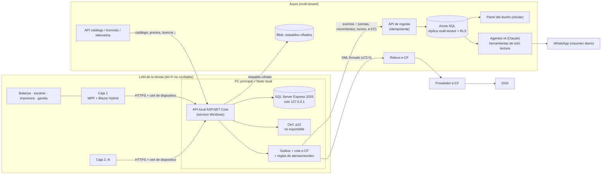

# Arquitectura V1: local, en la nube o híbrida

> Estado: **análisis para decidir**, 14 oct 2026. Complementa `read-v1.md` (contexto, e-CF, seguridad) y *planes* (doc. privado) (planes "Local" / "En línea", decisiones abiertas en la sección 5).
> Los datos de Microsoft y de Anthropic se verificaron en la web o en la referencia oficial en esta fecha. Lo que no se pudo verificar lleva la marca **(sin verificar)**.

---

## Recomendación

**Construir V1 híbrida con prioridad local ("local-first + nube como centro de servicios").** Cada tienda tiene un **nodo local**: la PC principal con la API ASP.NET Core como servicio de Windows, **SQL Server Express 2025** y el certificado .p12, al que se conectan todas las cajas por la LAN. Así se vende, se firma el e-CF y se comparten inventario y caja aunque se caiga el internet, que es la ventaja contra Alegra. Desde el primer día, ese nodo **envía eventos (ventas, movimientos, turnos, e-CF) a Azure** mediante un *outbox* propio y **recibe catálogo, precios y licencia**. En Azure viven la copia multi-tenant, el panel del dueño, el relevo hacia el proveedor e-CF, los respaldos y los **agentes de IA**, que solo leen esa copia. El modo **"En línea"** (sin PC servidor) y **Multisucursal** salen en la fase 2 con el mismo código de aplicación desplegado en Azure. En ese modo, cada caja guarda su caché offline en **SQLite**. **LocalDB no sirve para ninguno de los dos papeles.** Lo que hace posible el paso a la fase 2 se construye desde ya: backend con tenant, el mismo contrato de API en local y en la nube, claves GUID y outbox.

---

## 1. Las tres opciones

| | **A. Solo local** (offline-first puro) | **B. Nube primero + modo offline** | **C. Híbrida local-first + nube (recomendada)** |
|---|---|---|---|
| Dónde vive la verdad | PC principal de la tienda | Azure SQL | PC principal para la operación; Azure para la vista consolidada, IA y multisucursal |
| Qué hace la nube | Licencia y respaldos | Todo; cada caja guarda una caché | Ingesta de eventos, réplica, panel, IA, relevo e-CF, licencias, respaldos |
| Las cajas hablan con | API local por LAN | API en Azure, o la caché SQLite cuando no hay internet | API local por LAN. En la fase 2 "En línea", con la API en Azure y caché SQLite |
| Es igual a la opción de *planes* (doc. privado) | "Local" sin copia en la nube | "En línea" | "Local" (V1) y luego "En línea" (fase 2) con el mismo código |

### Matriz de decisión

Escala: ●●● fuerte · ●● aceptable · ● débil.

| Criterio | A. Solo local | B. Nube + modo offline | C. Híbrida (recomendada) |
|---|---|---|---|
| **Ventas sin internet** | ●●● Nada cambia | ●● Cada caja vende sola desde su caché; algunas funciones se desactivan | ●●● Nada cambia |
| **Varias cajas sin internet** (inventario y caja compartidos) | ●●● Una sola BD en la LAN | ● Cada caja es una isla, como Alegra. Inventario y totales se concilian al volver la conexión | ●●● Una sola BD en la LAN |
| **Cumplimiento e-CF** (firmar sin internet y enviar en 72 h) | ●●● Firma local en la PC principal | ● Solo si el .p12 está en una caja (opción 5.1-B), y aun así hay que repartir rangos de e-NCF por caja | ●●● Firma local y cola de contingencia; el relevo en la nube reintenta |
| **Agentes de IA** | ● No hay datos en la nube; solo funciones locales deterministas | ●●● Los datos ya están en la nube y siempre están frescos | ●● Usan la réplica, con minutos de retraso. Las alertas y el reorden se calculan también en local |
| **Costo por tenant** (nuestro) | ●●● ~US$0–1 (solo blob) | ●● ~US$5–10 (BD primaria, API, ancho de banda) | ●● ~US$1–4 (réplica compartida, ingesta y blob) **(estimado)** |
| **Esfuerzo de desarrollo** | ●●● El más bajo | ● Alto: caché offline por caja, conflictos, firma offline | ●● Medio: nodo local más ingesta de un solo sentido (arriba) y catálogo (abajo) |
| **Carga de soporte** | ● Alta: PC servidor, sin visibilidad remota del estado | ●●● La más baja: no hay servidor en la tienda | ●● Media: PC servidor, pero con telemetría y respaldos en la nube |
| **Tiempo al mercado** | ●●● El más rápido | ● El más lento si se exige e-CF offline | ●● Algo más que A: la ingesta y el panel pueden salir semanas después de la primera venta |

**Lectura:** B solo gana en soporte y en IA, pero pierde lo que nos diferencia (varias cajas sin internet) y complica el e-CF offline. A sale antes, pero deja al dueño sin celular ni IA y nos deja sin datos para dar soporte. C conserva la ventaja de A y añade la nube de forma incremental.

**Hallazgo clave para 5.1 de *planes* (doc. privado):** un modo "En línea" que emita e-CF válido sin internet necesita un equipo en la tienda con el certificado, la secuencia de e-NCF y una BD local. Eso es, en la práctica, un **nodo local**. Por eso conviene construir un solo producto, el nodo local, que se pueda instalar en dos topologías:

1. **PC principal** con varias cajas (V1).
2. **Caja única que también es nodo**, para el colmado de una caja (también V1: es el caso de 1 caja con la misma instalación).

Para la fase 2 quedaría el modo **"nube pura"**, sin nodo, con caché SQLite y e-CF firmado en Key Vault, que no puede emitir e-CF offline. Se vendería solo donde haya buen internet o con un 4G de respaldo (opción 5.1-C).

---

## 2. Restricciones duras

### 2.1 e-CF sin internet (contingencia)
- Sin internet hay que **emitir y firmar** el e-CF, imprimirlo con la nota de contingencia y **enviarlo a la DGII en un plazo de 72 h**. La serie B en papel **no** se permite por una simple caída de internet (ver `read-v1.md` §8).
- El código de seguridad sale de la firma, así que **la firma tiene que ser local**. Si el proveedor firma en su nube, se rompe el cumplimiento offline.
- **Secuencias e-NCF:** con un nodo local, ese nodo asigna los números a todas las cajas sin choques. Con cajas aisladas (opción B) hay que **reservar rangos por caja** de antemano, gestionar los huecos y anular los sobrantes, lo que añade otra fuente de errores fiscales.

### 2.2 Dónde vive el certificado .p12

| Opción | Ubicación | Riesgo |
|---|---|---|
| A / C (nodo local) | Almacén de certificados de Windows de la PC principal, **no exportable**, con acceso solo para la cuenta del servicio local | Robo de la PC: mitigar con BitLocker y la revocación del certificado. Nunca guardamos copia central |
| B con firma en la nube (5.1-A) | Azure Key Vault con clave no exportable | No hay e-CF offline. Además somos custodios de la clave, con la responsabilidad legal que eso implica |
| B con firma en una caja (5.1-B) | Una caja designada como "nodo fiscal" | Es un nodo local de hecho, sin sus ventajas: si esa caja se apaga, las demás no pueden firmar |

### 2.3 Varias cajas sin internet
Es la ventaja frente a Alegra (cuyo modo offline convierte cada dispositivo en una isla). Solo A y C la cumplen de forma natural: inventario y caja son **un libro único** en la BD del nodo, y cada venta descuenta stock y registra el movimiento de turno **en una sola transacción**.

**Punto débil de A/C:** la PC principal es un punto único de falla. Mitigación en V1:
- UPS.
- Respaldo cada hora más la réplica en la nube.
- Procedimiento documentado para "promover una caja a servidor" desde el último respaldo.

En V2 se puede añadir un **modo isla** en las cajas: SQLite con una cola de ventas, usado solo si el nodo cae. Esas ventas sin firmar se firmarían al volver el nodo, lo que hay que validar con la DGII y el proveedor.

---

## 3. Opciones de base de datos (la "versión ligera")

La "versión ligera" que el fundador no recordaba es casi seguro **SQL Server Express LocalDB**. Desde SQL Server 2025, LocalDB viene incluido en el instalador de Express.

| | **SQL Server Express 2025** | **SQL Server Express LocalDB** | **SQLite** (Microsoft.Data.Sqlite) | **Otras** |
|---|---|---|---|---|
| Tamaño máx. de BD | **50 GB** por base (2022 y anteriores: 10 GB) | Igual que Express | ~281 TB teórico (2^48 bytes); en la práctica, el límite del disco | PostgreSQL: sin límite práctico |
| Memoria | **1,410 MB** de buffer pool por instancia | Igual que Express | La del proceso; sin tope de edición | — |
| CPU | El menor de 1 socket o 4 núcleos | Igual que Express | La del proceso | — |
| ¿Corre como servicio? | **Sí**, servicio de Windows | **No**. Proceso en modo usuario que arranca con la primera conexión, bajo la cuenta del usuario. Microsoft advierte de problemas si el dueño es `NT AUTHORITY\SYSTEM` | No: es una librería dentro de nuestro proceso | PostgreSQL: servicio |
| Acceso por LAN / varias cajas | Sí (TCP, desactivado por defecto). **Para nosotros: solo en localhost**, y las cajas pasan por la API | **No** admite conexiones remotas; las "instancias compartidas" son solo para usuarios del mismo equipo | Las cajas **no** deben abrir el archivo por la red: SQLite advierte de corrupción en sistemas de archivos de red. Un solo escritor a la vez | PostgreSQL: sí |
| Licencia | Gratis, también en producción. Redistribuirlo en un instalador de ISV está permitido bajo los términos de Express (aceptar la EULA, aportar funcionalidad propia) **(términos de 2025 sin verificar; los de 2012/2019 lo permiten)** | Igual que Express | Dominio público | PostgreSQL: licencia libre tipo BSD |
| Instalación y huella | Instalador de cientos de MB y ~1 GB instalado **(tamaño sin verificar)**. Instalación silenciosa con `/Q /IACCEPTSQLSERVERLICENSETERMS /ACTION=Install` o archivo de configuración. Requiere admin | `SqlLocalDB.msi` de decenas de MB **(tamaño sin verificar)**. Instalación silenciosa con msiexec. Requiere admin | **Ninguna**: viene en el paquete NuGet (`e_sqlite3`, ~1–2 MB) | PostgreSQL: instalador de ~300 MB y otro motor que mantener |
| EF Core | Proveedor de primera (SQL Server), **el mismo que Azure SQL** | El mismo proveedor | Proveedor oficial con limitaciones: sin schemas ni secuencias. `decimal`, `DateTimeOffset` y `TimeSpan` solo admiten igualdad en SQL (ordenar y comparar se hace en el cliente). Las migraciones reconstruyen tablas y no hay scripts idempotentes | Npgsql, excelente |
| Funciones útiles | Change Tracking: sí. **SQL Agent: no** (los respaldos los programa nuestro servicio). **Backup cifrado: no. TDE: no** (cifrar el archivo nosotros y usar BitLocker) | Como Express, sin FILESTREAM ni administración remota | WAL, FTS5 y JSON | — |
| **(a) BD principal compartida por varias cajas** | ✅ **Recomendada.** Mismo motor y migraciones que Azure SQL, servicio estable y 50 GB bastan para años (ver nota) | ❌ No es un servicio, depende del perfil de un usuario y tiene un arranque lento en frío | ⚠️ Viable solo detrás de nuestra API (único escritor), pero el dinero en `decimal` se complica, se pierde la paridad con Azure SQL y hay que mantener dos dialectos | PostgreSQL: viable, pero rompe la coherencia con Azure y .NET/SQL Server |
| **(b) Caché offline por caja que sincroniza** | ❌ Demasiado pesada para cada caja (servicio y ~1 GB) | ⚠️ Funciona, pero exige un MSI con admin y un perfil de usuario, y no aporta nada sobre SQLite | ✅ **Recomendada.** Sin instalación, un archivo por caja, compatible con Dotmim.Sync y con el cliente offline de CommunityToolkit.Datasync **(cliente sin verificar en detalle)**. Guardar el dinero como `long` en centavos | SQL Server Compact: descontinuado, sin EF Core. LiteDB: NoSQL, sin EF Core |

**Nota de tamaño:** 150 facturas al día con ~5 líneas son unas 270 mil líneas al año, unos cientos de MB con índices. El XML de los e-CF (~10–20 KB cada uno, **estimado**) suma ~0.5–1 GB al año. Conviene guardarlo comprimido o en archivos aparte. Se tarda muchos años en llegar a 50 GB.

**Decisión:**
- **Nodo local:** SQL Server Express 2025, escuchando solo en localhost, con EF Core del proveedor SQL Server.
- **Caché por caja** (fase 2 "En línea", y el modo isla de V2): SQLite.
- Mantener la **capa de dominio independiente del proveedor**. Para el dinero, usar `decimal` en el dominio y un convertidor a centavos `long` en SQLite.

---

## 4. Sincronización

### 4.1 Opciones

| Opción | Estado (oct 2026) | A favor | En contra | Uso recomendado |
|---|---|---|---|---|
| **Azure SQL Data Sync** | **Se retira el 30 sep 2027.** Ya no permite crear grupos de sincronización en suscripciones que nunca lo usaron. Solo admite autenticación SQL | — | Retirado | **No usar** |
| **Dotmim.Sync** (MIT) | Última versión **1.3.0, de marzo 2025**. Admite SQL Server, SQLite y MySQL. Mantenido sobre todo por una persona | Sincroniza tablas en ambos sentidos y tiene proxy web ASP.NET Core | Riesgo de mantenimiento. Piensa en filas, no en hechos de negocio, y los conflictos se resuelven por fila | Plan B para la caché SQLite de la fase 2 si no queremos escribir la bajada |
| **Change Tracking + API propia** | Disponible en Express y en Azure SQL | Detecta qué filas cambiaron sin triggers | Hay que escribir la API y el manejo de versiones | **Bajada** de catálogo y precios (o usar `rowversion`) |
| **Outbox / eventos** (propio) | — | Ventas, movimientos, turnos y e-CF son **hechos inmutables**: idempotentes por GUID y sin conflictos. Sirve igual para la réplica, la IA, WhatsApp y la multisucursal | Hay que diseñar bien los eventos | **Subida**. **Recomendado** |
| **Nube primero con cola local** | — | Simple si la nube es la fuente de la verdad | Es la opción B: cajas aisladas | Solo para la fase 2 "nube pura" |

### 4.2 Diseño recomendado

- **Subida (tienda → nube):** tabla `Outbox` escrita **en la misma transacción** que la venta, el movimiento o el cierre. Un *worker* del servicio local la envía por HTTPS (con un token de dispositivo y, opcionalmente, mTLS) a `POST /ingest/{tenant}/events`. La nube aplica cada evento de forma **idempotente** (clave = EventId GUID) y responde con el último evento confirmado. Si no hay internet, se acumula sin límite práctico.
- **Bajada (nube → tienda):** catálogo, precios, impuestos, licencia y usuarios del panel, por cursor (`rowversion` o Change Tracking). Al volver la conexión se descargan los cambios posteriores al último cursor.
- **Reglas de conflicto:**
  1. **Datos maestros** (productos, precios, impuestos): en V1 local, **la tienda es la autoridad**; la nube solo recibe. Cuando se permita cambiar precios desde el celular (Multisucursal), el cambio baja como un **evento con fecha de vigencia**. Si coincide con una edición local, gana el último por marca de tiempo del servidor y queda en la auditoría.
  2. **Transacciones** (ventas, movimientos, turnos, e-CF): **solo se añaden; nunca se editan.** Las correcciones se hacen con eventos compensatorios (anulación, devolución, ajuste). No hay conflictos posibles.
  3. **El stock y el efectivo se calculan** como la suma de movimientos y nunca se sobrescriben. En la caché por caja de la fase 2, el stock offline es una estimación: al sincronizar se recalcula y, si queda negativo, se marca para conteo (ya previsto en *planes* (doc. privado)).
  4. **Secuencias e-NCF:** las asigna solo el nodo fiscal, nunca la nube mientras la tienda está offline.

---

## 5. Agentes de IA según la arquitectura

### 5.1 Qué necesita la nube y qué puede funcionar offline

| Función | ¿Necesita internet? | Qué funciona offline | Datos que usa |
|---|---|---|---|
| **Asistente del dueño** (preguntas sobre ventas, caja y stock) | Sí: el modelo es Claude en la nube, porque los modelos locales en las PCs de la tienda son lentos y débiles | Sin internet, la app muestra el **último resumen guardado** y los reportes locales deterministas. Las preguntas no se ponen en cola por defecto (pierden sentido a la hora); como mucho se ofrece "avíseme cuando vuelva la conexión" | Vistas de solo lectura: ventas por día, hora, producto y cajero; turnos y diferencias; stock y merma; compras |
| **Sugerencias de reorden** | El cálculo no; la explicación en lenguaje natural sí | **Fórmula determinista local**: venta media × tiempo de entrega + stock de seguridad − stock actual. El LLM solo la redacta y la prioriza | Movimientos de 4–8 semanas, proveedores y tiempos de entrega |
| **Alertas de anomalías** (anulaciones, descuentos, faltantes de caja) | La detección no; la notificación y la explicación sí | **Reglas locales** (umbrales, z-score por cajero), guardadas en la auditoría. Se envían al volver la conexión | Auditoría, anulaciones, descuentos, cierres a ciegas |
| **Foto de factura de proveedor → compra** | Sí (visión) | La foto se guarda en cola y el borrador se genera al volver la conexión | Imagen, catálogo de productos y proveedores (RNC) |
| **Resumen diario por WhatsApp** | Sí (LLM y WhatsApp Business API) | Los números se calculan en el nodo al cierre del día; el mensaje sale al volver la conexión | Cierre Z, ventas, top de productos, alertas |

**Regla de diseño:** todo lo que es **cálculo** (reorden, alertas, totales) es **código determinista**, que funciona offline y se puede auditar. El LLM **interpreta, redacta y extrae**. Así la IA nunca bloquea la operación y su costo queda acotado.

### 5.2 Beneficios y límites por arquitectura

| | A. Solo local | B. Nube primero | C. Híbrida |
|---|---|---|---|
| Datos disponibles para el agente | Solo en la tienda; el agente tendría que llamar a la PC (requiere túnel). **No recomendado** | Siempre en la nube y frescos | Réplica en Azure con unos minutos de retraso; cada respuesta indica "datos hasta las HH:MM" |
| Sin internet en la tienda | Sin IA. Solo reglas locales | La tienda pierde la IA. El dueño fuera de la tienda ve los datos hasta la última sincronización | Igual que B, pero las alertas y el reorden siguen calculándose en local |
| Latencia | — | 2–10 s por pregunta con herramientas **(estimado)** | Igual que B |
| Privacidad | Los datos no salen de la tienda | Todo está en Azure | Todo lo que se replica está en Azure. Al modelo solo le llegan **agregados** del resultado de las herramientas |
| Plan | Sin IA | IA en cualquier plan | IA desde **Negocio** (requiere la copia en la nube) |

### 5.3 Datos reales, solo lectura

- El agente **no escribe SQL libre en V1**. Usa **herramientas fijas con parámetros**: `ventas(periodo, sucursal, agrupación)`, `top_productos`, `diferencias_caja`, `stock_bajo`, `merma`, `compras_proveedor`. Cada una consulta **vistas** de la réplica con un usuario de BD que **solo tiene SELECT sobre esas vistas**, más **Row-Level Security por TenantId** (`SESSION_CONTEXT`), un tiempo límite y un tope de filas.
- **Las escrituras nunca son directas.** La foto de factura genera un **borrador de compra** y el reorden genera un **borrador de pedido**. Un usuario con permiso los confirma en la app, y la confirmación sigue el camino normal, con auditoría.
- **Datos mínimos al modelo:** sin nombres de clientes, cédulas, teléfonos ni montos de fiado por persona, salvo que el dueño pregunte por ellos explícitamente. Se usan códigos internos.
- Cada respuesta **cita su fuente**: la herramienta, el período y la frescura de los datos.

### 5.4 Costo por tenant con tope de uso

Precios de Anthropic (referencia oficial, oct 2026), en US$ por millón de tokens de entrada y salida:

| Modelo | Entrada / salida |
|---|---|
| Haiku 5.5 | $0.10 / $0.50 (prompts ≤100K tokens) |
| Sonnet 5.5 | $2 / $10 (lectura de caché: $0.20) |
| Opus 5.5 | $4 / $20 |
| Fable 5.1 | $10 / $50 |

Para estas tareas basta con **Haiku 5.5**, pasando a **Sonnet 5.5** en las preguntas difíciles y en la lectura de facturas.

| Uso mensual (tope sugerido) | Supuesto por unidad **(estimado)** | Costo/mes |
|---|---|---|
| 200 preguntas del dueño (80% Haiku, 20% Sonnet) | ~20K tokens de entrada y ~1.5K de salida por pregunta (3 llamadas con herramientas); Haiku ≈ US$0.003, Sonnet ≈ US$0.04–0.055 | ~US$2.7 |
| 30 resúmenes diarios (Haiku) | 6K de entrada y 600 de salida | ~US$0.03 |
| 50 facturas por foto (Sonnet) | ~4K de entrada (imagen y prompt) y 1.5K de salida ≈ US$0.023 | ~US$1.2 |
| Alertas: explicación (Haiku) | Despreciable | <US$0.1 |
| **Total en el tope** | | **~US$4** (todo con Sonnet: ~US$12) |

El add-on "Asistente IA" cuesta RD$990, ~US$14 sin ITBIS. **Cabe con margen si Haiku es el modelo por defecto.** Los mensajes de WhatsApp Business se cobran aparte según las tarifas de Meta **(sin verificar)**. Hay que medir el uso real con `usage` en cada respuesta y fijar el tope en preguntas al mes, no en tokens.

### 5.5 Privacidad

- La réplica en Azure (región en EE. UU.; no hay región de Azure en RD) y el envío de agregados a Anthropic deben figurar en la **promesa de datos** de *planes* (doc. privado) §6.
- Revisar los términos comerciales de la API de Anthropic sobre retención y uso de datos antes de publicar **(sin verificar en esta revisión)**.
- Las tiendas en "Local" sin copia en la nube (Esencial) **no tienen IA**: sus datos no salen de la tienda, y eso puede venderse como una ventaja.

---

## 6. Costos y operación

### 6.1 Costo de servir por tenant

| Concepto | A. Local | B. Nube primero | C. Híbrida |
|---|---|---|---|
| BD | Express local: US$0 | BD primaria. Una BD por tenant cuesta caro; mejor **una BD multi-tenant o un pool elástico** | **Una BD multi-tenant** para la réplica (con TenantId y RLS), o pocas *shards* |
| Referencia Azure SQL | — | Pool elástico Standard de 50–200 eDTU: ~US$110–440 al mes, **según una encuesta de terceros de ene 2026 (sin verificar en la calculadora oficial)**. Entre 50–100 tenants sale a ~US$2–5 por tenant solo en BD | La réplica tiene menos carga (escritura en lotes y lectura del panel): ~US$1–2 por tenant con 100 tenants **(estimado)** |
| Opción serverless | — | General Purpose serverless: mínimo 0.5 vCore, auto-pausa desde 15 min, cobro por segundo. Sirve para desarrollo y pruebas, no para la BD primaria de cajas | Útil en desarrollo y pruebas |
| API, ingesta, blob | — | App Service o Container Apps, más ancho de banda | Ingesta liviana; respaldos en blob a centavos por GB |
| **Total nube por tienda** | ~US$0–1 | ~US$5–10 (coincide con *planes* (doc. privado)) | ~US$1–4 |

El modelo híbrido mantiene los costos de *planes* (doc. privado) §8 ("Cloud ~US$1" en Esencial y "~US$8" en Negocio, que queda holgado). El costo que más mueve el precio sigue siendo el **e-CF** (5.2).

### 6.2 Instalación y soporte

- **Asistente de configuración (nodo):**
  - Instalación silenciosa de Express 2025, con `TCPENABLED=0` o escuchando solo en localhost **(verificar los parámetros exactos de 2025)**.
  - Servicio de Windows, regla de firewall en el perfil privado, certificado HTTPS propio, importación del .p12 como no exportable y activación de licencia.
  - Instalar Express requiere admin y tarda varios minutos. Conviene **preinstalarlo en los kits de hardware**.
- **Asistente de configuración (caja):** descubre el nodo y se empareja con un código de un solo uso y el PIN de admin (ya en `read-v1.md`).
- **Soporte remoto:** el nodo envía **telemetría de salud** a la nube: cola outbox, cola e-CF, vencimiento del certificado, último respaldo, espacio en disco y versión. Esto convierte muchas visitas en una alerta y es una ventaja de C sobre A. Para casos concretos, NetBird.
- Requisito mínimo de SQL Server 2025 en Windows 10/11 **(sin verificar; revisar los requisitos de SO de 2025 antes de fijar la ficha de hardware)**.

### 6.3 Actualizaciones (Velopack)

- Velopack (MIT) da **instaladores y actualizaciones delta** para la app de escritorio.
- No documenta soporte para **servicios de Windows** **(sin verificar)**. Plan: la app de caja en el nodo se actualiza con Velopack y trae los binarios del servicio. Un *hook* de actualización con privilegios detiene el servicio, hace un respaldo, aplica las migraciones EF y reinicia el servicio.
- Política de versiones: **la API local acepta la versión N y la N-1 del cliente**, para que las cajas se actualicen en distinto momento. Las migraciones de esquema solo se añaden (*expand/contract*).

### 6.4 Respaldos

Express no tiene SQL Agent, compresión ni **cifrado de respaldos**, así que el servicio hace lo siguiente:

1. `BACKUP DATABASE` completo cada noche y del log cada hora (modelo de recuperación FULL), o un completo cada hora porque la BD es pequeña.
2. Cifra el archivo con AES (clave por tenant guardada en la nube y respaldada por el dueño).
3. Lo sube a Azure Blob (inmutable o versionado, 30 días).
4. Hace una **prueba de restauración** periódica en la nube.

Más una copia local en un disco USB opcional.

### 6.5 Seguridad

| Amenaza | Local (A/C) | Nube (B) |
|---|---|---|
| Wi-Fi compartido y hostil | SQL solo en localhost; API con HTTPS fijado y certificados de dispositivo revocables; PIN con bloqueo; roles validados en el servidor | TLS a Azure; tokens por dispositivo |
| Robo de la PC | **BitLocker** (Express no tiene TDE), .p12 no exportable, respaldo en la nube | No hay datos locales, salvo la caché SQLite (cifrarla con SQLCipher o DPAPI) **(SQLCipher sin verificar)** |
| Ransomware | Respaldo inmutable en la nube | El riesgo se traslada a la nube |
| Fuga entre tenants | — | **RLS por TenantId**, pruebas automáticas de aislamiento, identidad administrada y Key Vault |

---

## 7. Arquitectura V1 recomendada

**Fase 2 ("En línea" y Multisucursal):** la misma capa de aplicación (los mismos casos de uso y el mismo contrato OpenAPI) se despliega en Azure sobre Azure SQL. Hay dos topologías:

- **Caja con nodo local de una sola máquina**, que conserva el e-CF offline.
- **Nube pura con caché SQLite por caja**, con firma en Key Vault y sin e-CF offline, opción 5.1-A o 5.1-C de *planes* (doc. privado).

La multisucursal recibe los eventos de cada nodo en la nube, que ya existe, y baja el catálogo común.

### 7.1 Qué construir desde el día 1 para no cerrar puertas

1. **Tenant y sucursal en todo:** `TenantId`, `BranchId` y `DeviceId` en cada fila y evento, aunque en local haya uno solo. Filtros globales de EF Core.
2. **Claves GUID** (preferir GUID v7 o secuencial para no fragmentar índices en SQL Server).
3. **Un solo contrato de API** (OpenAPI) y una sola capa de aplicación. Cambia el *host* (servicio local o Azure), no el código.
4. **Outbox transaccional y eventos de dominio versionados** desde la primera venta, aunque la ingesta en la nube llegue después.
5. **Transacciones de solo inserción**; stock y caja calculados como libros de movimientos.
6. **Interfaces externas:** `IEcfProvider`, `IEcfSigner` (local o Key Vault), `IClock`, `IFeatureService`, `IScale`, `IPrinter`.
7. **El dinero en `decimal`** en el dominio y nada específico de SQL Server en las consultas del dominio (para poder usar SQLite en la caché).
8. **Vistas de reporte con nombre estable** (las mismas que usarán el panel y la IA).

### 7.2 Orden de construcción

| # | Entregable | Notas |
|---|---|---|
| 0 | Esqueleto: dominio, aplicación, API local, EF Core (SQL Server), outbox, tenant y GUID; pruebas de integración contra Express | Base de todo lo demás |
| 1 | Productos e inventario (unidades y peso, compras, ajustes, conteos, costo promedio) | Orden de `read-v1.md` |
| 2 | POS con varias cajas y turnos (emparejamiento, balanza, impresora, gaveta, cierre a ciegas, Z) | La ventaja competitiva |
| 3 | e-CF: firma local, cola de contingencia, relevo en la nube, impresión con QR | Bloqueado por 5.2 (proveedor y XML prefirmado) |
| 4 | Instalador y asistente, Velopack, respaldo cifrado a blob y telemetría de salud | Necesario para el piloto |
| 5 | **Piloto en 1–3 carnicerías** | |
| 6 | Ingesta en la nube y réplica multi-tenant con RLS, licencias en la nube | Habilita Negocio |
| 7 | Panel en el celular y resumen diario por WhatsApp | |
| 8 | Asistente IA (herramientas de solo lectura), alertas, reorden y foto de factura (borradores) | Add-on |
| 9 | Fase 2: "En línea" (API en Azure y caché SQLite) y Multisucursal | Decidir 5.1 y 5.4 con datos del piloto |

---

## 8. Esfuerzo y riesgo (desarrollador casi solo, con IA)

| Bloque | Riesgo | Por qué |
|---|---|---|
| Nodo local y POS con varias cajas | Medio | Stack conocido (.NET, EF y SQL Server). Lo difícil es el hardware y la UX |
| e-CF offline | **Alto** | Depende del proveedor (XML prefirmado), de la certificación DGII y del manejo de secuencias |
| Instalador y servicio Windows | Medio | Express silencioso, permisos y actualizaciones del servicio. Mucho trabajo de detalle |
| Outbox → réplica | Medio-bajo | Solo inserción e idempotente, sin conflictos |
| Sincronización bidireccional (fase 2) | **Alto** | Por eso se pospone y se limita a catálogo abajo y hechos arriba |
| Agentes IA de solo lectura | Bajo-medio | Herramientas fijas sobre vistas. El riesgo está en la calidad de las respuestas y en el costo; se controla con topes |

---

## 9. Riesgos y preguntas abiertas

**Riesgos**

1. **Plazo e-CF del 15 nov 2026.** La ola de adopción de pymes es ahora. V1 local llega después, y muchas tiendas ya habrán elegido proveedor. Se puede mitigar con migración de proveedor e-CF fácil (ECF SSD la menciona) y con argumentos de venta de "cambio sin perder historial".
2. **El proveedor no acepta XML prefirmado.** Sin eso, la firma local no sirve. Alternativas: Grodtech (acepta XML) o envío directo a la DGII (requiere ser PSFE o integrarse por cuenta del contribuyente).
3. **PC principal como punto único de falla:** UPS, respaldo cada hora, procedimiento de "promover caja" y modo isla en V2.
4. **Instalar Express en PCs viejas o con poco disco o RAM:** fijar la ficha mínima (por ejemplo 8 GB de RAM y SSD) y vender kits.
5. **Dotmim.Sync tiene poca actividad** (última versión de marzo 2025). No hacerlo dependencia central.
6. **Costo de la IA si el uso se dispara:** topes por plan, Haiku por defecto, caché de prompts y medición con `usage`.
7. **Privacidad y confianza:** explicar en una página qué sube a la nube y qué ve la IA.
8. **Azure SQL Data Sync** sigue apareciendo en tutoriales: no usarlo (se retira el 30 sep 2027).

**Preguntas abiertas**

- ¿El proveedor e-CF acepta XML firmado por nosotros, y cuenta las RFCE de consumo? (5.2 en *planes* (doc. privado)).
- ¿Express 2025 o 2022 en el nodo? 2025 da 50 GB e incluye LocalDB en el mismo instalador. Confirmar los requisitos de SO de 2025 y los términos de redistribución vigentes.
- ¿Se permite firmar en un "modo isla" de caja sin el nodo (V2)? Validarlo con el proveedor.
- ¿Una BD multi-tenant única o un pool elástico con una BD por tenant cuando haya más de 200 tiendas? Empezar con una BD y TenantId; la migración a *shards* es posible con TenantId en todas partes.
- ¿Qué región de Azure usar (latencia desde RD: East US 2 o South Central US)? ¿Hay requisitos de residencia de datos?
- ¿Cuánto cuesta realmente WhatsApp Business (plantillas de "utility") al mes por tienda?
- 5.4 de *planes* (doc. privado) (Multisucursal solo En línea): con este diseño, la **multisucursal Local** se reduce a varios nodos que suben eventos a la misma nube más un catálogo común que baja. Es más barata de lo que se pensaba, siempre que **no** se comparta stock en vivo entre sucursales.

---

## Fuentes

- Ediciones y límites de SQL Server 2025 (Express: 50 GB, 1,410 MB, 1 socket/4 núcleos; sin Agent, sin cifrado de respaldos, sin TDE; Change Tracking sí): https://learn.microsoft.com/en-us/sql/sql-server/editions-and-components-of-sql-server-2025
- SQL Server Express LocalDB (modo usuario, sin administración remota, instancias compartidas solo locales, problemas con SYSTEM, incluido en Express 2025): https://learn.microsoft.com/en-us/sql/database-engine/configure-windows/sql-server-express-localdb
- Limitaciones del proveedor SQLite de EF Core: https://learn.microsoft.com/en-us/ef/core/providers/sqlite/limitations
- SQLite: cuándo usarlo (red, un escritor, tamaño): https://www.sqlite.org/whentouse.html
- Retiro de SQL Data Sync (30 sep 2027): https://learn.microsoft.com/en-us/azure/azure-sql/database/sql-data-sync-data-sql-server-sql-database
- Azure SQL serverless: https://learn.microsoft.com/en-us/azure/azure-sql/database/serverless-tier-overview
- Precios de pools elásticos (terceros, referencia): https://spendark.com/blog/azure-sql-pricing-explained/ · https://cloudtoolstack.com/tools/azure-sql-dtu-calculator
- Dotmim.Sync: https://github.com/Mimetis/Dotmim.Sync · https://www.nuget.org/packages/Dotmim.Sync.Core
- CommunityToolkit Datasync: https://github.com/CommunityToolkit/Datasync
- Velopack: https://github.com/velopack/velopack · https://docs.velopack.io/
- Instalación silenciosa de Express (terceros): https://silentinstallhq.com/microsoft-sql-server-2022-express-silent-install-how-to-guide/ · https://wingetly.io/apps/microsoft/sqlserver-2025-express/silent-install
- Redistribución de SQL Express (histórico): https://learn.microsoft.com/en-us/archive/blogs/sqlexpress/faq-can-i-redistribute-sql-express · https://www.microsoft.com/en-us/download/details.aspx?id=29693
- Modelos y precios de Claude: referencia oficial de la API de Anthropic (skill `claude-api`, caché del 6 oct 2026); página pública: https://www.anthropic.com/pricing
- Contexto propio: `read-v1.md` (e-CF, contingencia, seguridad) y *planes* (doc. privado).
